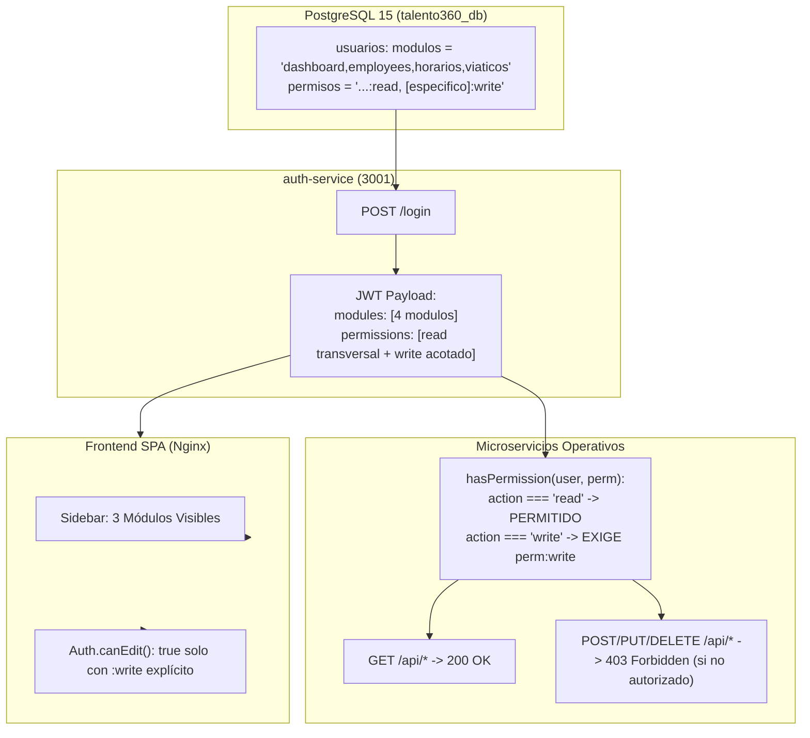

# AUDITORÍA 04: INFORME DE REMEDIACIÓN DEL HALLAZGO RBAC (AUD-4-001)
## Restablecimiento de Lectura Cruzada Transversal y Protección Estricta de Escritura

---

### 1. DESCRIPCIÓN DEL PROBLEMA
Durante la Cuarta Auditoría Integral se detectó el hallazgo `AUD-4-001` (Severidad ALTA). Al implementar el aislamiento modular en la remediación previa, se asignó a cada funcionaria únicamente su módulo primario en la base de datos (`usuarios.modulos`). 

En consecuencia, el middleware `canRead(moduleName)` y los componentes frontend denegaban el acceso de lectura (`GET`) con código HTTP `403 Forbidden` a las funcionarias cuando intentaban consultar datos operativos en módulos distintos a su especialidad directa:
- Ángela Ussa y Blanca Soler recibían 403 en Horarios y Viáticos.
- Doris Cañón recibía 403 en Servidores Públicos y Viáticos.
- Bergenet Gutiérrez recibía 403 en Servidores Públicos y Horarios.

Este comportamiento contravenía la directriz de la Gobernación de Boyacá, la cual exige una **visión operativa compartida (Solo Lectura / VER)** para auditoría y consulta interdepartamental, manteniendo restringidas exclusivamente las operaciones de escritura y mutación (`CRUD`).

---

### 2. CAUSA RAÍZ IDENTIFICADA
1. **Configuración en Base de Datos:** La columna `modulos` de la tabla `usuarios` contenía valores excluyentes (`dashboard,employees`, `dashboard,horarios`, `dashboard,viaticos`) y carecía de una columna de permisos explícitos (`permisos`).
2. **Generación de JWT en `auth-service`:** La función `resolvePermissions(role, modules)` derivaba automáticamente permisos de escritura (`:write`, `:delete`, `:import`) siempre que un módulo figuraba en la lista de módulos permitidos, impidiendo conceder lectura en un módulo sin otorgar al mismo tiempo permisos de mutación.
3. **Middleware de Rutas (`hasPermission`):** En `employees-service`, `viaticos-service` y `horarios-service`, la lógica de `hasPermission(user, requiredPerm)` concedía acceso si `mods.includes(mod)`, permitiendo involuntariamente que si un módulo se agregaba a `modulos`, el usuario pudiera escribir en él.
4. **Validaciones en Frontend (`auth.js`):** La función `Auth.canEdit(moduleName)` evaluaba `mods.includes(targetMod)`, por lo que al habilitar la visibilidad en el menú lateral, se mostraban botones de edición y creación.

---

### 3. ARQUITECTURA DE LA SOLUCIÓN IMPLEMENTADA



---

### 4. ARCHIVOS INTERVENIDOS Y CAMBIOS TÉCNICOS

#### 4.1. Base de Datos: Script de Migración `database/26_rbac_cross_module_read_and_permissions.sql`
- Se agregó la columna `permisos TEXT` en la tabla `usuarios`.
- Se asignó a las 4 funcionarias institucionales (`angela.ussa`, `blanca.soler`, `doris.canon`, `bergenet.gutierrez`) acceso a todos los módulos operativos: `'dashboard,employees,horarios,viaticos'`.
- Se configuró la cadena de permisos granulares exactos:
  - **Ángela y Blanca:** `dashboard:read,employees:read,employees:write,employees:delete,employees:import,employees:export,horarios:read,viaticos:read`
  - **Doris:** `dashboard:read,employees:read,horarios:read,horarios:write,horarios:delete,viaticos:read`
  - **Bergenet:** `dashboard:read,employees:read,horarios:read,viaticos:read,viaticos:write,viaticos:status,viaticos:import,viaticos:delete`
  - **Admin:** `*` en módulos y `*` en permisos.

#### 4.2. `web/services/auth-service/src/routes/auth.js`
- Se actualizó la consulta de login y actualización de perfil para recuperar la columna `permisos`.
- Se refactorizó la función `resolvePermissions(role, modules, explicitPerms)` para respetar los permisos granulares definidos en la base de datos cuando existen:
  ```javascript
  function resolvePermissions(role, modules, explicitPerms = null) {
    const r = (role || '').toLowerCase();
    const mods = Array.isArray(modules) ? modules : [];
    if (r === 'administrador' || r === 'admin' || mods.includes('*')) return ['*'];

    if (explicitPerms && typeof explicitPerms === 'string' && explicitPerms.trim() !== '') {
      const list = explicitPerms.split(',').map(p => p.trim().toLowerCase()).filter(Boolean);
      if (list.length > 0) return list;
    }
    // Fallback estándar...
  }
  ```

#### 4.3. Middlewares de Autorización en Microservicios Operativos
Se actualizó la función `hasPermission(user, requiredPerm)` en:
- `web/services/employees-service/src/routes/employees.js`
- `web/services/viaticos-service/src/routes/viaticos.js`
- `web/services/horarios-service/src/routes/horarios.js`

**Lógica refinada:**
```javascript
// 2. Verificación estricta de permiso granular
if (requiredPerm) {
  if (perms.includes(requiredPerm)) return true;
  const [mod, action] = requiredPerm.split(':');
  if (perms.includes(`${mod}:*`)) return true;
  // Si la acción es lectura (read) y el módulo está asignado (sin restricción de solo escritura)
  if (action === 'read' && mods.includes(mod)) return true;
  // Para escritura (write/delete/import/export), NO basta tener el nombre del módulo en mods si perms existe
  if (perms.length === 0 && mods.includes(mod)) return true;
  if (action === 'write' && (mods.includes(`${mod}_write`) || mods.includes(`${mod}:write`))) return true;
}
```

#### 4.4. Microservicios Secundarios (`AUD-4-002` Mitigado)
En `requests-service`, `admin-requests-service` y `sst-service` se reemplazaron las comprobaciones permisivas basadas en subcadenas (`role.toLowerCase().includes('administrador')`) por evaluaciones de igualdad estricta y validación de permisos en el payload (`requests:write`, `sst:write`).

#### 4.5. Frontend SPA (`web/frontend/src/js/auth.js`)
Se ajustó `Auth.canEdit(moduleName)` para exigir permisos explícitos de escritura (`:write`) antes de habilitar controles de edición en la interfaz:
```javascript
// 3. Verificación de permisos explícitos de mutación (write/delete/manage)
if (perms.includes(`${targetMod}:write`) || perms.includes(`${targetMod}:*`)) return true;
if (mods.includes(`${targetMod}_write`) || mods.includes(`${targetMod}:write`)) return true;
if (perms.length === 0 && mods.includes(targetMod)) return true;

return false;
```

---

### 5. MATRIZ DE COMPORTAMIENTO: ANTES Y DESPUÉS

| Usuario | Operación Evaluada | Comportamiento Anterior (Auditoría 4) | Comportamiento Nuevo Post-Remediación | Estado |
|---|---|:---:|:---:|:---:|
| **angela.ussa** | Consultar Horarios (`GET /api/horarios`) | 403 Forbidden | **200 OK** | **RESUELTO** |
| **angela.ussa** | Consultar Viáticos (`GET /api/viaticos`) | 403 Forbidden | **200 OK** | **RESUELTO** |
| **angela.ussa** | Crear Horario (`POST /api/horarios`) | 403 Forbidden | **403 Forbidden** | **PROTEGIDO** |
| **angela.ussa** | Eliminar Viático (`DELETE /api/viaticos/1`) | 403 Forbidden | **403 Forbidden** | **PROTEGIDO** |
| **doris.canon** | Consultar Servidores (`GET /api/employees`) | 403 Forbidden | **200 OK** | **RESUELTO** |
| **doris.canon** | Consultar Viáticos (`GET /api/viaticos`) | 403 Forbidden | **200 OK** | **RESUELTO** |
| **doris.canon** | Crear Servidor (`POST /api/employees`) | 403 Forbidden | **403 Forbidden** | **PROTEGIDO** |
| **doris.canon** | Crear Horario (`POST /api/horarios`) | 200/400 (Permitido) | **200/400 (Permitido)** | **CONFORME** |
| **bergenet.gutierrez** | Consultar Servidores (`GET /api/employees`) | 403 Forbidden | **200 OK** | **RESUELTO** |
| **bergenet.gutierrez** | Consultar Horarios (`GET /api/horarios`) | 403 Forbidden | **200 OK** | **RESUELTO** |
| **bergenet.gutierrez** | Crear Servidor (`POST /api/employees`) | 403 Forbidden | **403 Forbidden** | **PROTEGIDO** |
| **bergenet.gutierrez** | Eliminar Horario (`DELETE /api/horarios/1`) | 403 Forbidden | **403 Forbidden** | **PROTEGIDO** |
| **bergenet.gutierrez** | Crear Viático (`POST /api/viaticos`) | 200/400 (Permitido) | **200/400 (Permitido)** | **CONFORME** |
| **Cualquiera no admin**| Acceso a Backups (`/api/admin/backups`) | 403 Forbidden | **403 Forbidden** | **PROTEGIDO** |
| **Anónimo / No auth**  | Consultar Módulos sin Token | 401 Unauthorized | **401 Unauthorized** | **PROTEGIDO** |

---

### 6. RIESGOS MITIGADOS Y CONSIDERACIONES DE SEGURIDAD
1. **Prevención de Escalamiento Horizontal (BOLA / IDOR):** Las usuarias no adquieren privilegios de mutación por tener acceso de lectura. Las rutas `POST`, `PUT`, `PATCH` y `DELETE` rechazan incondicionalmente las solicitudes no autorizadas en el backend con código 403.
2. **Protección de la Administración Global:** Los microservicios de administración (`/api/admin/backups`, `/api/admin/errors`) exigen estrictamente el rol `'Administrador'`, manteniendo a los 4 usuarios institucionales bloqueados de las consolas técnicas de logs y respaldos.
3. **No Afectación de Reglas de Negocio en Viáticos:** El módulo de Viáticos permanece como un sistema documental, de consulta estadística y carga Excel, sin habilitar motores de liquidación o cálculo tarifario.

