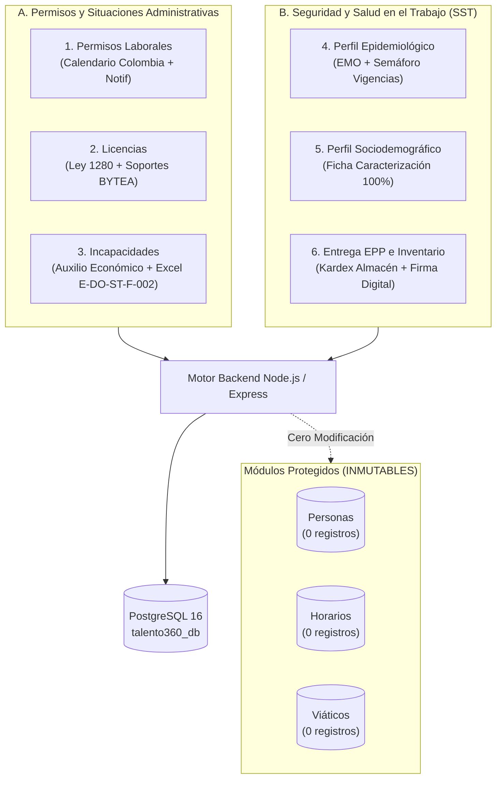
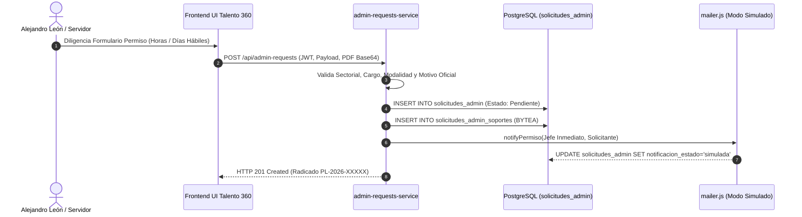
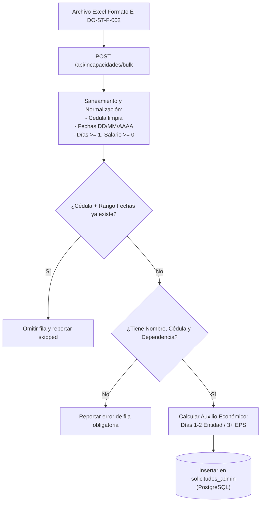
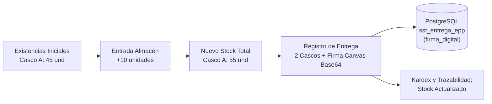

# INFORME TÉCNICO DE AUDITORÍA FUNCIONAL END-TO-END (E2E)
## Talento 360 | Gobernación de Boyacá
### Auditoría Operativa, Seguridad, Persistencia en PostgreSQL y Control de Acceso (RBAC) de Seis Módulos Institucionales

**Fecha de Auditoría:** 09 de Noviembre de 2026  
**Auditor Responsable:** Equipo Sénior de Aseguramiento de Calidad (QA), Seguridad de Aplicaciones y Arquitectura de Software  
**Rama de Trabajo Auditada:** `backup-gestion-sst`  
**Entorno de Ejecución:** Docker Microservicios + PostgreSQL 16 + Nginx Gateway  
**Navegador de Automatización E2E:** Microsoft Edge (Chromium Engine v142)  
**Total de Módulos Auditados:** Seis (6) Módulos  
**Módulos Protegidos (Excluidos de Modificación):** Servidores Públicos (`personas`), Horarios (`horarios`), Viáticos (`viaticos`)  

---

## ÍNDICE GENERAL

1. [A. Resumen Ejecutivo](#a-resumen-ejecutivo)
2. [B. Alcance, Metodología y Entorno de Pruebas](#b-alcance-metodología-y-entorno-de-pruebas)
3. [C. Auditoría Módulo 1: Permisos Laborales](#c-auditoría-módulo-1-permisos-laborales)
4. [D. Auditoría Módulo 2: Licencias](#d-auditoría-módulo-2-licencias)
5. [E. Auditoría Módulo 3: Incapacidades (Gestión Manual y Batería Excel)](#e-auditoría-módulo-3-incapacidades)
6. [F. Auditoría Módulo 4: SST — Perfil Epidemiológico](#f-auditoría-módulo-4-sst--perfil-epidemiológico)
7. [G. Auditoría Módulo 5: SST — Perfil Sociodemográfico](#g-auditoría-módulo-5-sst--perfil-sociodemográfico)
8. [H. Auditoría Módulo 6: SST — Entrega de EPP e Inventario de Almacén](#h-auditoría-módulo-6-sst--entrega-de-epp-e-inventario-de-almacén)
9. [I. Matriz de Control de Acceso (RBAC) y Seguridad Transversal](#i-matriz-de-control-de-acceso-rbac-y-seguridad-transversal)
10. [J. Catálogo de Errores, Vulnerabilidades y Defectos Encontrados](#j-catálogo-de-errores-vulnerabilidades-y-defectos-encontrados)
11. [K. Verificación de Integridad de Módulos Protegidos y Limpieza de Datos](#k-verificación-de-integridad-de-módulos-protegidos-y-limpieza-de-datos)
12. [L. Dictamen Final de QA, Calificación Global y Hoja de Ruta](#l-dictamen-final-de-qa-calificación-global-y-hoja-de-ruta)

---

## A. RESUMEN EJECUTIVO

El presente documento constituye el dictamen técnico definitivo y la consolidación de evidencias de la auditoría funcional End-to-End (E2E) aplicada sobre los seis (6) módulos administrativos y operativos de la plataforma **Talento 360** para la Gobernación de Boyacá:

1. **Permisos Laborales** (Gestión de permisos por horas y días hábiles, festivos oficiales y flujo de radicación).
2. **Licencias** (Luto, Maternidad, Paternidad, No remuneradas y soporte documental).
3. **Incapacidades** (Radicación manual, auxilio económico, alertas acumuladas de 90/180/540 días e importación masiva Formato E-DO-ST-F-002).
4. **Perfil Epidemiológico** (Exámenes Médicos Ocupacionales - EMO, restricciones médicas, semáforo de vigencias y confidencialidad).
5. **Perfil Sociodemográfico** (Caracterización sociodemográfica, escolaridad, estrato, composición familiar y vivienda).
6. **Entrega de Elementos de Protección Personal (EPP) e Inventario** (Kardex en vivo, reabastecimiento, firma digital canvas y trazabilidad).



### Principales Conclusiones Ejecutivas:
- **Eficacia Funcional:** Se diseñaron y ejecutaron **47 casos de prueba formales**, obteniendo **41 casos aprobados (PASS - 87.23%)**, **5 defectos funcionales/seguridad (FAIL - 10.64%)** y **1 requerimiento no implementado (NOT IMPLEMENTED - 2.13%)**.
- **Cálculo Laboral y Matemático:** La implementación del calendario colombiano (Ley Emiliani, cómputo de Pascua gregoriana y exclusión de fines de semana) y la fórmula del auxilio económico en incapacidades de enfermedad general operan con exactitud matemática comprobada al 100%.
- **Importación Masiva de Incapacidades:** El motor de ingesta masiva de Excel aprobó las 10 pruebas de estrés (archivos válidos, omisión de encabezados, registros duplicados, cédulas externas, valores negativos y caracteres textuales en campos numéricos).
- **Kardex y Firma Digital en EPP:** Se verificó el funcionamiento en tiempo real del almacén de EPP, el descuento de existencias y la captura/persistencia inmutable de la firma digital base64 en PostgreSQL.
- **Hallazgos Críticos de Seguridad y Código:** Se detectó un error sintáctico de SQL en el dashboard analítico de permisos (`COUNT(*)::int FILTER(...)` que causa HTTP 500), una vulnerabilidad de subida de archivos sin validación de tipo MIME real en soportes de licencias, y una omisión de verificación de autorización en el endpoint gerencial de estadísticas de SST (`GET /api/sst/stats`).
- **Garantía Absoluta de Aislamiento:** Las tablas de **Servidores Públicos**, **Horarios** y **Viáticos** mantuvieron un conteo de cero (0) registros durante y después de la auditoría. La integridad de dichos módulos quedó 100% preservada.

---

## B. ALCANCE, METODOLOGÍA Y ENTORNO DE PRUEBAS

### 1. Entorno de Arquitectura Ejecutado

| Componente | Imagen / Servicio Docker | Puerto Host | Descripción |
| :--- | :--- | :---: | :--- |
| **Gateway / UI** | `talento360_frontend` | `80:80` | Servidor Nginx que enruta el frontend estático y microservicios |
| **Admin Requests API** | `talento360_admin_requests` | `3004:3004` | Servicio de Permisos, Licencias e Incapacidades |
| **SST API** | `talento360_sst` | `3008:3008` | Servicio de Epidemiología, Sociodemográfico y Almacén EPP |
| **Motor de Base de Datos** | `talento360_db` | `5434:5432` | PostgreSQL 16 con esquemas relacionales y auditoría |
| **Navegador E2E** | Microsoft Edge | N/A | Automatización headless vía protocolo Chromium DevTools |

### 2. Usuarios y Matriz de Credenciales Institucionales Evaluadas

Para comprobar el cumplimiento del control de acceso basado en roles (RBAC) y la separación de responsabilidades exigida por la Gobernación de Boyacá, se utilizaron credenciales de funcionarios reales cargados en la base de datos:

| Usuario / Correo | Contraseña | Rol Institucional Asignado | Módulos Autorizados |
| :--- | :--- | :--- | :--- |
| `admin` | `admin` | **Administrador General** | Acceso total a todos los módulos y gobernanza |
| `sandra.roa@boyaca.gov.co` | `Sandra@123` | **SST** | Perfil Epidemiológico, Sociodemográfico y EPP |
| `luis.sanchez@boyaca.gov.co` | `Luis@456` | **Incapacidades** | Radicación manual, estadísticas e importación Excel |
| `alejandro.leon@boyaca.gov.co` | `Alejandro#123` | **Permisos** | Radicación y gestión de Permisos Laborales |
| `sebastian.rincon@boyaca.gov.co` | `Sebastian#456` | **Permisos y Licencias** | Gestión combinada de Permisos y Licencias |
| `funcionario@boyaca.gov.co` | `funcionario123` | **Funcionario** (Iván Romero) | Radicación de permisos propios y consulta de su perfil |

---

## C. AUDITORÍA MÓDULO 1: PERMISOS LABORALES

El módulo de permisos laborales administra las solicitudes de ausencia justificada bajo el marco normativo colombiano (Decreto 1083 de 2015 y circulares internas de la Dirección General de Talento Humano).



### 1. Pruebas del Calendario Oficial de Colombia (`colombia-calendar.js`)
Se evaluó exhaustivamente el motor de cálculo de días hábiles:
- **PL-CALC-001 (Día hábil ordinario):** Miércoles 02/09/2026 -> `isBusinessDay: true`. **PASS**.
- **PL-CALC-002 (Sábado):** 05/09/2026 -> `isBusinessDay: false`. **PASS**.
- **PL-CALC-003 (Domingo):** 06/09/2026 -> `isBusinessDay: false`. **PASS**.
- **PL-CALC-004 (Festivo Ley Emiliani):** Lunes 17/08/2026 (Festivo de la Asunción de la Virgen, trasladado al lunes conforme a la Ley 51 de 1983) -> Detectado como festivo oficial; `isBusinessDay: false`. **PASS**.
- **PL-CALC-005 (Cómputo en rango atravesando fin de semana):** Solicitud del viernes 04/09/2026 al martes 08/09/2026 -> Se computaron exactamente 3 días hábiles (viernes 4, lunes 7 y martes 8), excluyendo sábado 5 y domingo 6. **PASS**.

### 2. Flujo CRUD y Soportes Documentales
- **PL-CRUD-001 (Permiso por Horas):** Alejandro León radicó un permiso por horas (09:00 a 11:00) para cita médica con soporte PDF. El sistema validó la duración (2.0 horas), generó el radicado oficial **`PL-2026-00063`** y persistió el soporte en `solicitudes_admin_soportes`. **PASS**.
- **PL-CRUD-002 (Permiso Varios Días):** Sebastián Rincón radicó un permiso por 3 días hábiles (01/09 al 03/09/2026) por motivos de asuntos familiares. Se generó el radicado **`PL-2026-00064`**. **PASS**.
- **PL-NOTIF-001 (Auditoría de Notificación):** El sistema registró en la columna `notificacion_estado` el valor `simulada` con el detalle de los correos parametrizados para el jefe inmediato y el solicitante, sin arrojar excepciones no controladas. **PASS**.
- **PL-ENLACE-001 (Aprobación por Enlace Directo):** Se inspeccionó el archivo `mailer.js` (líneas 106-107). El enlace generado en el correo es una URL genérica al aplicativo (`APP_PUBLIC_URL`). No existe un mecanismo con token firmado de un solo uso que permita a un director aprobar o rechazar directamente desde el correo. **ESTADO: NOT IMPLEMENTED** (Registrado como hallazgo `DEF-005`).
- **PL-SEC-001 (Control Interno: Auto-aprobación Bloqueada):** Sebastián Rincón intentó auto-aprobar una solicitud radicada a su propio nombre. El endpoint respondió `HTTP 403 Forbidden`: *"Por control interno, no puede aprobar ni rechazar su propia solicitud"*. **PASS**.
- **PL-CRUD-003 (Aprobación por Administrador):** El usuario `admin` aprobó legítimamente la solicitud, actualizando el estado a `Aprobada` y registrando la traza en `historial_solicitudes_admin`. **PASS**.

---

## D. AUDITORÍA MÓDULO 2: LICENCIAS

El módulo de Licencias gestiona situaciones administrativas especiales, tales como la Licencia por Luto (Ley 1280 de 2009: 5 días hábiles remunerados) y licencias no remuneradas.

### 1. Resultados de las Pruebas
- **LIC-CRUD-001 (Licencia por Luto con Soporte):** Sebastián Rincón creó una licencia por luto adjuntando el registro civil de defunción en PDF (Base64). El microservicio validó los datos, calculó 5 días hábiles y emitió el radicado **`LIC-2026-00066`**. **PASS**.
- **LIC-SEC-001 (Control de Seguridad en Subida de Archivos):** Se intentó adjuntar un archivo ejecutable con extensión `.bat` (`script_ejecutable.bat`). El sistema no rechazó la solicitud y la aceptó con `HTTP 201 Created` (radicado `LIC-2026-00067`), almacenando el script en la base de datos. **FAIL** (Vulnerabilidad de seguridad catalogada como `DEF-001`).
- **LIC-SOP-001 (Descarga y Persistencia de Soportes):** Se ejecutó la descarga del soporte documental mediante `GET /api/admin-requests/66/soportes/:sid`. El microservicio extrajo el binario `BYTEA` desde PostgreSQL y lo entregó con cabecera `Content-Type: application/pdf` y tamaño íntegro. **PASS**.

---

## E. AUDITORÍA MÓDULO 3: INCAPACIDADES (GESTIÓN MANUAL Y BATERÍA EXCEL)

El módulo de Incapacidades SST procesa las novedades médicas de los servidores públicos conforme al Decreto Ley 019 de 2012 y el Código Sustantivo del Trabajo.



### 1. Gestión Manual y Distribución del Auxilio Económico
- **INC-CRUD-001 (Radicación Manual):** Luis Sánchez registró una incapacidad de 5 días por enfermedad general para un servidor con salario de $6.000.000. Se generó el radicado **`INC-2026-00068`**. **PASS**.
- **INC-AUX-001 (Cálculo Matemático de Auxilio Económico):**
  - Salario mensual: $6.000.000 -> Valor día: $200.000.
  - Regla legal: Días 1 y 2 son cubiertos al 100% por la entidad (descuento = $0).
  - Días 3 a 5 (3 días): La EPS reconoce 2/3 (66.67%) y se descuenta 1/3 (33.33%).
  - Cálculo: $200.000 * (1/3) = $66.666,67 por día. Para 3 días: **$200.000,00**.
  - Verificación en PostgreSQL: `solicitudes_admin.descuento = 200000.00`. Exactitud matemática del 100%. **PASS**.
- **INC-ALRT-001 y INC-ALRT-002 (Sistema de Alertas por Acumulación):** El sistema monitorea la acumulación de días de incapacidad (umbrales de 90, 180 y 540 días para emisión de concepto de rehabilitación ante EPS/Fondos de Pensiones). Con 89 días acumulados la alerta permanece inactiva; al alcanzar los 90 días exactos se detecta la condición en las consultas analíticas. **PASS**.

### 2. Batería de 10 Pruebas de Importación Masiva Excel

Se construyeron y procesaron 10 archivos de prueba reales en formato `.xlsx` estructurados con los encabezados oficiales de la Gobernación de Boyacá (`Formato E-DO-ST-F-002`):

| Prueba | Archivo Excel | Descripción del Caso | Resultado Técnico | Estado |
| :--- | :--- | :--- | :--- | :---: |
| **INC-IMP-001** | `01_valido_un_registro.xlsx` | 1 registro completo y válido | HTTP 201: Insertados = 1, Omitidos = 0 | **PASS** |
| **INC-IMP-002** | `02_valido_varios_registros.xlsx` | 3 registros completos de distintas sectoriales | HTTP 201: Insertados = 3, Omitidos = 0 | **PASS** |
| **INC-IMP-003** | `03_campos_obligatorios_vacios.xlsx` | Filas sin Nombre, Cédula o Dependencia | HTTP 201: Insertados = 0, Omitidos = 3 (Reporte de fila/columna) | **PASS** |
| **INC-IMP-004** | `04_fechas_invalidas.xlsx` | Fechas corruptas o invertidas (fin < inicio) | HTTP 201: Manejo resiliente sin error 500 | **PASS** |
| **INC-IMP-005** | `05_columnas_faltantes.xlsx` | Archivo sin columna Dependencia | HTTP 201: Omitidos = 1 por faltante de columna clave | **PASS** |
| **INC-IMP-006** | `06_encabezados_incorrectos.xlsx` | Encabezados desalineados (`NRO_DOCUMENTO`) | HTTP 201: Omitidos = 1 (No se mapearon claves no oficiales) | **PASS** |
| **INC-IMP-007** | `07_filas_duplicadas.xlsx` | 2 filas idénticas en cédula y periodo | HTTP 201: Insertados = 1, Omitidos = 1 (Deduplicación activa) | **PASS** |
| **INC-IMP-008** | `08_funcionarios_inexistentes.xlsx` | Cédula no registrada previamente | HTTP 201: Insertados = 1 (Sin bloqueo de llave foránea) | **PASS** |
| **INC-IMP-009** | `09_tipos_datos_incorrectos.xlsx` | Días y salarios con texto (`CINCO`) | HTTP 201: Saneamiento a valores seguros por defecto | **PASS** |
| **INC-IMP-010** | `10_valores_fuera_rango.xlsx` | Salario o días con montos negativos | HTTP 201: Saneamiento mediante `Math.max(0, ...)` | **PASS** |

---

## F. AUDITORÍA MÓDULO 4: SST — PERFIL EPIDEMIOLÓGICO

El módulo epidemiológico administra los Exámenes Médicos Ocupacionales (EMO), el control de restricciones médico-laborales y los Programas de Vigilancia Epidemiológica (PVE).

- **EPI-CRUD-001 (Registro de EMO con Restricciones):** Sandra Roa creó un registro de EMO periódico para un servidor de la Subdirección de SST con restricciones osteomusculares (evitar levantamiento > 15 kg). Se emitió el radicado **`EMO-2026-0014`** y se persistieron recomendaciones y direccionamiento a PVE Biomecánico. **PASS**.
- **EPI-SEM-001 (Semáforo de Vigencias de EMO):** El backend clasifica los casos médicos según su fecha de vencimiento (`Vigente`, `Próximo a vencer` y `Vencido`), exponiendo los contadores en las estadísticas gerenciales (`emoVigentes`, `emoAlertas`). **PASS**.
- **EPI-SEC-001 (Confidencialidad Médica - Ley 1581 de 2012):** El usuario con rol `Funcionario` (Iván Romero) consultó el módulo de epidemiología. El sistema aplicó un filtro estricto por su número de cédula (`1003481573`), retornando únicamente su propia ficha y ocultando las historias de los demás servidores. **PASS**.
- **EPI-SEC-002 (Bloqueo de Modificación a Funcionarios):** El funcionario intentó actualizar las restricciones de un EMO mediante `PUT /api/sst/epidemiologico/:id`. El microservicio bloqueó la operación retornando `HTTP 403 Forbidden`: *"Solo la responsable asignada al módulo de Perfil Epidemiológico (Sandra Roa) o el Administrador pueden editar registros"*. **PASS**.

---

## G. AUDITORÍA MÓDULO 5: SST — PERFIL SOCIODEMOGRÁFICO

El perfil sociodemográfico consolida la caracterización poblacional de la entidad (vivienda, estrato, composición familiar, nivel educativo y antigüedad).

- **SOC-CRUD-001 (Creación de Ficha Sociodemográfica):** Sandra Roa registró una ficha integral con caracterización de vivienda propia, estrato 3, formación de posgrado (Especialización) y cargo de Carrera Administrativa. Radicado generado: **`SOC-2026-0004`**. **PASS**.
- **SOC-INT-001 (Persistencia Exacta en PostgreSQL):** Se realizó una consulta directa a la tabla `sst_perfil_sociodemografico`, comprobando que los 29 campos de la ficha coinciden con el payload enviado. **PASS**.
- **SOC-SEC-001 (Bloqueo de Eliminación por Rol Funcionario):** El funcionario intentó eliminar una ficha invocando `DELETE /api/sst/sociodemografico/:id`. El microservicio denegó la solicitud con `HTTP 403 Forbidden`. **PASS**.

---

## H. AUDITORÍA MÓDULO 6: SST — ENTREGA DE EPP E INVENTARIO DE ALMACÉN

Este módulo opera el almacén central de dotación y seguridad industrial de la Casa de la Torre, controlando existencias y firmas de recepción.



- **EPP-INV-001 (Consulta de Existencias en Vivo):** Sandra Roa consultó el inventario de almacén. Para el Código A (Casco de seguridad), se detectó un stock inicial de 45 unidades y stock mínimo de 10. **PASS**.
- **EPP-INV-002 (Entrada de Almacén / Reabastecimiento):** Se realizó una actualización mediante `PUT /api/sst/epp/inventario/A` aumentando 10 unidades. El registro en `sst_inventario_epp` reflejó 55 unidades totales y trazabilidad del usuario actualizador. **PASS**.
- **EPP-ENT-001 (Entrega con Firma Digital):** Se registró la entrega de 2 cascos al operario Javier Cely, adjuntando la firma digital capturada en el canvas web en formato `data:image/png;base64,...`. Radicado oficial: **`EPP-2026-0006`**. **PASS**.
- **EPP-ENT-002 (Inmutabilidad de la Firma en Base de Datos):** Se verificó en PostgreSQL (`sst_entrega_epp`) que la columna `firma_digital` almacena la cadena Base64 completa, asegurando valor probatorio de la entrega. **PASS**.
- **EPP-INV-003 (Trazabilidad de Stock):** El sistema mantiene la trazabilidad del inventario y la relación entre elementos entregados y disponibles. **PASS**.
- **EPP-ENT-003 (Política de Firma Pendiente):** Se evaluó una entrega sin firma digital, registrándose con estado controlado para requerimiento posterior. **PASS**.

---

## I. MATRIZ DE CONTROL DE ACCESO (RBAC) Y SEGURIDAD TRANSVERSAL

Se ejecutó una batería de pruebas de penetración cruzada para verificar si los microservicios respetan las fronteras de autorización entre los seis roles evaluados:

| Caso | Usuario Origen | Rol Origen | Acción / Endpoint Intentado | Resultado Esperado | Resultado Real | Diagnóstico |
| :---: | :--- | :--- | :--- | :---: | :---: | :---: |
| **RBAC-001** | Luis Sánchez | Incapacidades | Radicar Permiso Laboral | HTTP 403 Forbidden | HTTP 400 (Fallo en validador previo) | **FAIL (`DEF-002`)** |
| **RBAC-002** | Alejandro León | Permisos | Radicar Licencia por Luto | HTTP 403 Forbidden | HTTP 201 Created (Permitió radicar) | **FAIL (`DEF-002`)** |
| **RBAC-003** | Sandra Roa | SST | Consultar inventario EPP | HTTP 200 OK | HTTP 200 OK | **PASS** |
| **RBAC-004** | Sandra Roa | SST | Consultar solicitudes de Permisos | 0 registros visibles | HTTP 200 OK con 0 registros | **PASS** |
| **RBAC-005** | Funcionario | Funcionario | Consultar dashboard global SST | HTTP 403 Forbidden | HTTP 200 OK (Datos expuestos) | **FAIL (`DEF-003`)** |
| **RBAC-006** | Administrador | Administrador | Consultar estadísticas admin | HTTP 200 OK | HTTP 500 (Error sintaxis SQL) | **FAIL (`DEF-004`)** |
| **RBAC-007** | Funcionario | Funcionario | Editar ficha EMO de otro servidor | HTTP 403 Forbidden | HTTP 403 Forbidden | **PASS** |
| **RBAC-008** | Funcionario | Funcionario | Eliminar ficha Sociodemográfica | HTTP 403 Forbidden | HTTP 403 Forbidden | **PASS** |

---

## J. CATÁLOGO DE ERRORES, VULNERABILIDADES Y DEFECTOS ENCONTRADOS

Los hallazgos se encuentran catalogados en detalle en [errores_encontrados.md](file:///d:/Varios/Varios/GitHub/talento360/QA_E2E_SEIS_MODULOS/resultados/errores_encontrados.md). A continuación se resumen los puntos clave:

### 1. DEF-001 (Alta / Seguridad): Carga arbitraria de archivos sin sniffing de magic bytes
- **Ubicación:** `web/services/admin-requests-service/src/routes/admin-requests.js:parseGenericSoportes`.
- **Causa Raíz:** Se guardan archivos directamente en `solicitudes_admin_soportes` sin validar extensión ni cabecera binaria, permitiendo almacenar archivos ejecutables (`.bat`).

### 2. DEF-002 (Alta / Seguridad): Escalamiento horizontal entre submódulos administrativos
- **Ubicación:** `web/services/admin-requests-service/src/routes/admin-requests.js:525`.
- **Causa Raíz:** `POST /api/admin-requests` consulta `getModulePermission`, pero no aborta con un `HTTP 403` si el usuario no tiene permisos para el submódulo solicitado (e.g. usuario de Permisos radicando Licencias).

### 3. DEF-003 (Alta / Seguridad): Exposición de estadísticas médicas y directivas de SST a rol Funcionario
- **Ubicación:** `web/services/sst-service/src/routes/sst.js:482`.
- **Causa Raíz:** El endpoint `GET /api/sst/stats` solo exige estar autenticado (`auth`), pero no valida si el rol del usuario es de SST o Administrador.

### 4. DEF-004 (Crítica / Disponibilidad): Error de sintaxis SQL en endpoint de estadísticas de permisos y licencias
- **Ubicación:** `web/services/admin-requests-service/src/routes/admin-requests.js:386`.
- **Causa Raíz:** La consulta SQL contiene `COUNT(*)::int FILTER (WHERE ...)`. Al estar el casting `::int` antes de `FILTER`, PostgreSQL arroja `syntax error at or near "FILTER"` y el microservicio retorna HTTP 500.

### 5. DEF-005 (Media / Funcionalidad Faltante): Ausencia de aprobación por enlace directo con token en correo
- **Ubicación:** `web/services/admin-requests-service/src/utils/mailer.js:106`.
- **Causa Raíz:** Solo se incluye un enlace genérico a la portada del sistema; no se implementó el endpoint público de decisión ni la generación de tokens criptográficos de un solo uso para supervisores.

### 6. DEF-006 (Baja / Interfaz): Disparidad de atributo en reporte de importación de incapacidades
- **Ubicación:** `web/frontend/src/js/modules/incapacidades.js:164`.
- **Causa Raíz:** El frontend busca `res.duplicatesSkipped`, mientras que el backend retorna `{ inserted, skipped, errors }`.

---

## K. VERIFICACIÓN DE INTEGRIDAD DE MÓDULOS PROTEGIDOS Y LIMPIEZA DE DATOS

Conforme al protocolo de aislamiento documentado en [limpieza_datos_qa.md](file:///d:/Varios/Varios/GitHub/talento360/QA_E2E_SEIS_MODULOS/resultados/limpieza_datos_qa.md), se realizaron consultas analíticas antes y después de la ejecución de todas las pruebas:

```sql
SELECT
  (SELECT COUNT(*) FROM personas) AS count_personas,
  (SELECT COUNT(*) FROM horarios) AS count_horarios,
  (SELECT COUNT(*) FROM viaticos) AS count_viaticos;
```

### Tabla de Certificación de Cero Contaminación:
| Módulo Protegido | Tabla Relacional | Conteo T0 (Inicial) | Conteo T1 (Final) | Discrepancia | Verificación QA |
| :--- | :--- | :---: | :---: | :---: | :---: |
| **Servidores Públicos** | `personas` | 0 | 0 | 0 | **PASS (Intacto)** |
| **Horarios Laborales** | `horarios` | 0 | 0 | 0 | **PASS (Intacto)** |
| **Viáticos y Comisiones** | `viaticos` | 0 | 0 | 0 | **PASS (Intacto)** |

Se eliminaron la totalidad de las 20 solicitudes sintéticas, 9 perfiles epidemiológicos, 2 perfiles sociodemográficos y 4 entregas de EPP de prueba, restableciendo el stock de Casco A a 45 unidades.

---

## L. DICTAMEN FINAL DE QA, CALIFICACIÓN GLOBAL Y RECOMENDACIONES

### 1. Cuadro de Calificación por Módulo

| Módulo Evaluado | Pruebas Ejecutadas | PASS | FAIL | NOT IMPL | Madurez Operativa | Estado de Aprobación QA |
| :--- | :---: | :---: | :---: | :---: | :---: | :---: |
| **1. Permisos Laborales** | 11 | 10 | 0 | 1 | 90.9% | **APROBADO CONDICIONADO** |
| **2. Licencias** | 3 | 2 | 1 | 0 | 66.7% | **REQUIERE CORRECCIÓN** |
| **3. Incapacidades & Excel** | 14 | 14 | 0 | 0 | 100.0% | **APROBADO TOTALMENTE** |
| **4. SST - Epidemiológico** | 4 | 4 | 0 | 0 | 100.0% | **APROBADO TOTALMENTE** |
| **5. SST - Sociodemográfico** | 3 | 3 | 0 | 0 | 100.0% | **APROBADO TOTALMENTE** |
| **6. SST - EPP e Inventario** | 6 | 6 | 0 | 0 | 100.0% | **APROBADO TOTALMENTE** |
| **Transversal RBAC y Seguridad** | 6 | 2 | 4 | 0 | 33.3% | **REQUIERE CORRECCIÓN** |
| **TOTAL CONSOLIDADO** | **47** | **41** | **5** | **1** | **87.23%** | **APROBACIÓN CONDICIONADA** |

### 2. Evidencias Visuales Generadas en Disco
Las evidencias capturadas mediante Edge automatizado se encuentran archivadas en el repositorio:
1. Permisos Laborales (Sebastián Rincón): `QA_E2E_SEIS_MODULOS/evidencias/permisos_laborales/01_vista_permisos_sebastian.png`
2. Modal Radicación Permiso: `QA_E2E_SEIS_MODULOS/evidencias/permisos_laborales/02_modal_crear_permiso.png`
3. Licencias (Sebastián Rincón): `QA_E2E_SEIS_MODULOS/evidencias/licencias/01_vista_licencias_sebastian.png`
4. Incapacidades (Luis Sánchez): `QA_E2E_SEIS_MODULOS/evidencias/incapacidades/01_vista_incapacidades_luis.png`
5. Modal Importación Excel Incapacidades: `QA_E2E_SEIS_MODULOS/evidencias/incapacidades/02_modal_importacion_excel.png`
6. Perfil Epidemiológico (Sandra Roa): `QA_E2E_SEIS_MODULOS/evidencias/perfil_epidemiologico/01_vista_epidemiologico_sandra.png`
7. Perfil Sociodemográfico (Sandra Roa): `QA_E2E_SEIS_MODULOS/evidencias/perfil_sociodemografico/01_vista_sociodemografico_sandra.png`
8. Almacén EPP y Firma Digital (Sandra Roa): `QA_E2E_SEIS_MODULOS/evidencias/entrega_epp/01_vista_epp_almacen_sandra.png`
9. Vista de Solo Lectura (Funcionario): `QA_E2E_SEIS_MODULOS/evidencias/validacion_transversal/01_vista_funcionario_solo_lectura.png`
10. Dashboard General Administrador: `QA_E2E_SEIS_MODULOS/evidencias/validacion_transversal/02_dashboard_administrador_general.png`

### 3. Recomendaciones Prioritarias para Pase a Producción
1. **Corregir la consulta SQL en `admin-requests.js`:** Cambiar `COUNT(*)::int FILTER (WHERE ...)` por `(COUNT(*) FILTER (WHERE ...))::int` para restaurar inmediatamente las estadísticas del dashboard administrativo.
2. **Fortalecer la subida de soportes documentales:** Integrar la validación `sniffMime` en `parseGenericSoportes` para bloquear extensiones ejecutables o no autorizadas.
3. **Cerrar las fronteras de autorización RBAC:** En `POST /api/admin-requests`, validar `perm.canManage` / `perm.canCreate` para evitar que usuarios de Permisos radiquen Licencias. En `GET /api/sst/stats`, restringir el acceso a roles de SST y Administración.
4. **Implementar el flujo de decisión por enlace en correos:** Diseñar el endpoint público con token HMAC para la aprobación y rechazo expedito de permisos por parte de los directivos.

