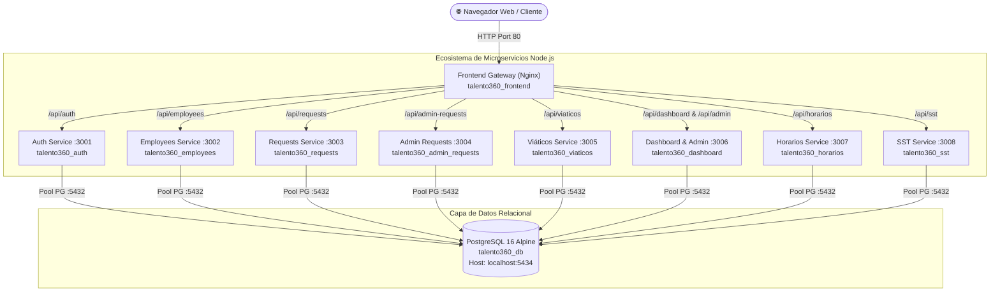
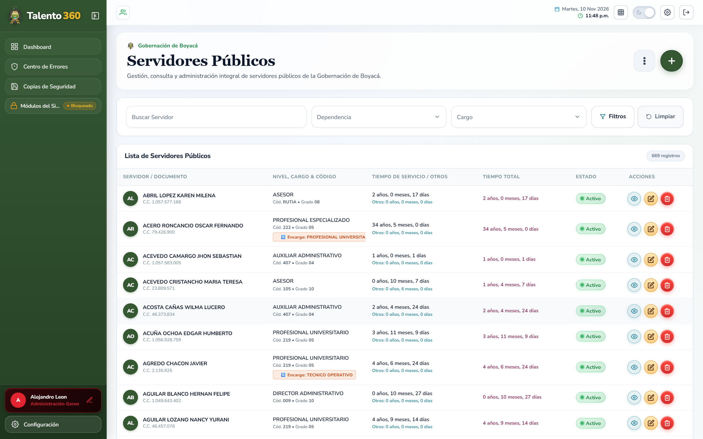
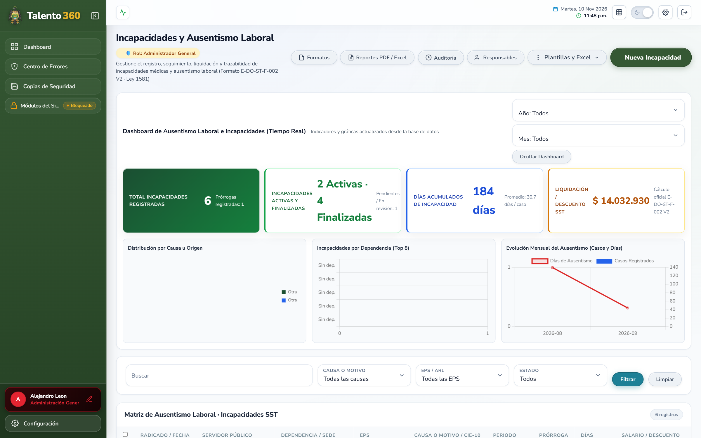
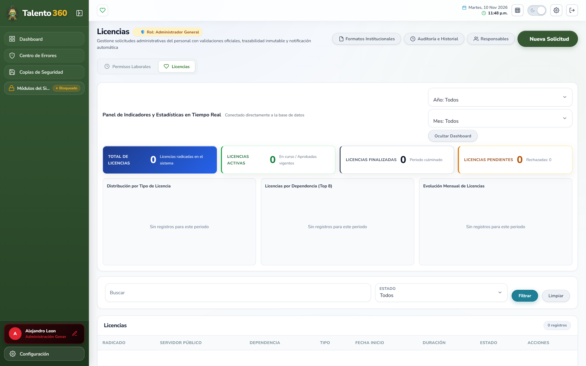

# Talento 360 — Plataforma de Gestión de Talento Humano

[](https://nodejs.org/)
[](https://www.postgresql.org/)
[](https://www.docker.com/)
[](https://nginx.org/)
[](https://www.w3.org/WAI/standards-guidelines/wcag/)
[-brightgreen)](AUDITORIAS/)
[](LICENSE)

Plataforma web institucional de alta disponibilidad y seguridad para la administración integral del talento humano de la **Gobernación de Boyacá**. Diseñada para centralizar y automatizar la gestión de la planta de servidores públicos, modalidades laborales concertadas, comisiones de viáticos con motor normativo, trámites administrativos, vacaciones y **Seguridad y Salud en el Trabajo (SST)**.

Construida con una arquitectura de microservicios desacoplados en **Node.js / Express**, base de datos relacional **PostgreSQL 16**, frontend SPA de alto rendimiento con interfaz reactiva, diseño accesible (WCAG 2.1 AA), generación de reportes ejecutivos en PDF de alta fidelidad y un blindaje exhaustivo de ciberseguridad y no-regresión operativa (**CWE-1236, OWASP Top 10, RBAC estricto**).

---

## 📚 Documentación Clave

- 🚀 **[Guía de Despliegue en Servidor Local Linux (On-Premise)](./GUIA_DESPLIEGUE_SERVIDOR_LINUX.md):** Manual paso a paso, amigable y detallado para instalar Ubuntu Server y correr los 10 contenedores en el servidor de la entidad.
- 📁 **[Archivo Central de Auditorías y Certificaciones](./AUDITORIAS/):** Directorio consolidado con las auditorías técnicas, matrices de permisos y el informe consolidado maestro ([`AUDITORIA_FINAL_TALENTO_360.md`](./AUDITORIAS/AUDITORIA_FINAL_TALENTO_360.md)).
- ☁️ **[Despliegue Alternativo en la Nube (Netlify + Render)](./docs/DEPLOY_NETLIFY_RENDER.md):** Guía de arquitectura para despliegue en entornos cloud.
- 🎨 **[Manual de Marca y Colorimetría Institucional](./docs/branding/colorimetria.md):** Paleta visual y directrices de diseño oficial de la Gobernación de Boyacá.

---

## 🏛️ Módulos de la Plataforma

- **📊 Dashboard Integral y Analítico:**
  - Paneles adaptados dinámicamente por rol operativo (`admin`, `angela`, `blanca`, `doris`, `bergenet`).
  - Indicadores KPI en tiempo real: servidores activos, plazas vacantes, inactivos/retirados y distribución departamental por secretarías.
  - Generador de informes ejecutivos en **PDF de alta resolución**: formato institucional estandarizado en 2 páginas completas, gráficos vectoriales, cabecera limpia *Talento 360* y área oficial para firmas físicas o digitales.

- **👥 Directorio y Gestión de Servidores Públicos:**
  - Hoja de vida digital y administración integral de la planta institucional (personal activo, plazas vacantes enumeradas y servidores retirados con motivo y fecha formal de desvinculación).
  - **Generación atómica de identificadores `REL`** (`REL00001`...): bloqueos consultivos de concurrencia para evitar colisiones en creación paralela.
  - Flujo formal de retiro con congelamiento de antigüedad y flujo de **reincorporación / revinculación** que preserva el acumulado de tiempos de servicio.
  - Homologación de niveles jerárquicos (*Directivo, Asesor, Profesional, Técnico, Asistencial*), validación estricta de 22 reglas institucionales de datos y catálogo geográfico **DIVIPOLA**.
  - Motor de importación masiva desde plantillas Excel (`.xlsx`) con sanitización DTO, omisión de filas fantasma y reporte de inconsistencias.

- **⏰ Horarios y Modalidades Laborales Especiales:**
  - Administración de esquemas concertados: **Teletrabajo** (autónomo, suplementario, móvil), **Trabajo en Casa** y **Horario Flexible**.
  - Control de concurrencia: prevención estricta de acuerdos simultáneos con traslape de fechas para un mismo funcionario.
  - **Retorno automático a presencialidad:** motor que detecta acuerdos vencidos y los transiciona a `Caducada`, retornando al funcionario a presencialidad ordinaria sin tuplas redundantes.
  - **Pausa y reanudación automática de vacaciones:** cuando un servidor activa una modalidad de *Trabajo en casa*, las vacaciones vigentes se pausan administrativamente y se reanudan al caducar el acuerdo.

- **✈️ Comisiones y Viáticos (Motor Normativo):**
  - Radicación, liquidación y seguimiento de comisiones departamentales (catálogo oficial de los **123 municipios de Boyacá**), nacionales y especiales.
  - **Motor de liquidación automática 2024–2026:** evaluación de escalas salariales reglamentadas por decretos del Gobierno Nacional y Departamental, cálculo automático de pernoctadas y tarifas diarias oficiales.
  - **Máquina de estados canónica:** flujo administrativo `Radicado` $\rightarrow$ `Aprobado` $\rightarrow$ `En Ejecución` $\rightarrow$ `Legalizado`.
  - **Protección contable y fiscal:** bloqueo estricto que impide la eliminación física o alteración de comisiones en estado `Legalizado`, constituyendo soporte presupuestal cerrado y auditable.
  - Carga diferida de soportes documentales bajo demanda (`GET /api/viaticos/:id/soporte`) para optimizar el rendimiento de la red.

- **🏖️ Gestión de Vacaciones y Novedades:**
  - Radicación de solicitudes de vacaciones ordinarias y compensadas.
  - Cálculo dinámico de días hábiles descontando fines de semana y festivos oficiales de Colombia.
  - Flujo de aprobación por talento humano y trazabilidad cronológica.

- **📋 Trámites y Solicitudes Administrativas:**
  - Gestión de permisos laborales remunerados, incapacidades médicas con soporte y licencias (maternidad, paternidad, luto, remuneradas y no remuneradas).

- **🦺 Seguridad y Salud en el Trabajo (SST):**
  - Vigilancia epidemiológica y seguimiento a Exámenes Médicos Ocupacionales (EMO).
  - Matriz de entrega y dotación de Elementos de Protección Personal (EPP).
  - Caracterización sociodemográfica de la planta institucional.

- **🛡️ Centro de Monitoreo, Errores y Copias de Seguridad (Administrador Técnico):**
  - **Consola de Errores e Incidentes:** captura global de excepciones con clasificación automática por severidad (`Critica`, `Alta`, `Media`, `Baja`), seguimiento de errores HTTP 404/500, inspección de stack trace y ciclo hacia estado `Resuelto`.
  - **Resolución Segura de IP:** configuración de `trust proxy` en Express que previene la suplantación de identidad mediante cabeceras spoofeadas (`X-Real-IP`, `X-Forwarded-For`).
  - **Copias de Seguridad (Backups) Nativas:** motor de respaldo en streaming mediante cliente nativo `pg` (sin llamadas inseguras al shell del sistema operativo), control de cuota de almacenamiento, descargas autenticadas con token Bearer y endpoint de verificación de integridad en sandbox con rollback transaccional automático.

---

## 🔒 Ciberseguridad y Aseguramiento Técnico (AUD-001 — AUD-014)

La plataforma cuenta con una arquitectura de seguridad robusta certificada mediante auditoría integral:

| Hallazgo / Vector | Mitigación Implementada |
|---|---|
| **CWE-1236 (Formula / CSV Injection)** | Sanitización exhaustiva en `ExcelService` que neutraliza disparadores (`=`, `+`, `-`, `@`, `\|`, `%`, `\t`) anteponiendo `'` mientras preserva números negativos (`-1500`) y fechas válidas. Exportación CSV con prefijo UTF-8 Byte Order Mark (`\uFEFF`). |
| **Control de Sesión y Expiración 401** | Interceptor centralizado en `api.js` que despliega un modal in-situ de autenticación (`z-index: 100000`) sin perder el contexto de la aplicación, complementado con captura y restauración segura de borradores de formularios (`saveCurrentFormDraft` / `restoreCurrentFormDraft`). |
| **Protección Criptográfica JWT** | Validación de arranque que impide el inicio de los microservicios en entorno de producción si `JWT_SECRET` está ausente o utiliza valores predeterminados inseguros. |
| **Control de Acceso Basado en Roles (RBAC)** | Modelo granular desacoplado del nombre de usuario basado en permisos (`employees:write`, `horarios:write`, `viaticos:write`, `admin:*`), garantizando aislamiento por área. |
| **Integridad Referencial de Base de Datos** | 29 tablas normalizadas con claves foráneas estrictas, índices B-Tree de consulta rápida y protección referencial (`ON DELETE RESTRICT`) para expedientes y comisiones históricas. |
| **Georreferenciación Oficial DIVIPOLA** | Catálogo oficial del DANE para los 123 municipios de Boyacá integrado en servidores y viáticos con autocompletado y validación de destino. |

---

## 🏗️ Arquitectura y Microservicios

El sistema opera bajo un entorno contenerizado orquestado mediante **Docker Compose**:



### Detalle de Contenedores

| Servicio | Contenedor | Puerto Interno | Puerto Host | Responsabilidad |
|---|---|---|---|---|
| **Frontend Gateway** | `talento360_frontend` | `80` | `80` | Servidor Nginx SPA, reverse proxy hacia microservicios y distribución de estáticos |
| **Auth Service** | `talento360_auth` | `3001` | Interno | Autenticación JWT, verificación de credenciales, roles y permisos granulares |
| **Employees Service** | `talento360_employees` | `3002` | Interno | Planta de personal, secuencia `REL`, hojas de vida, retiros e importador masivo Excel |
| **Requests Service** | `talento360_requests` | `3003` | Interno | Radicación, cómputo de días hábiles colombianos y aprobaciones de vacaciones |
| **Admin Requests** | `talento360_admin_requests` | `3004` | Interno | Permisos remunerados, incapacidades médicas con soporte y licencias |
| **Viáticos Service** | `talento360_viaticos` | `3005` | Interno | Comisiones de servicio, motor tarifario 2024–2026, DIVIPOLA y estados canónicos |
| **Dashboard Service** | `talento360_dashboard` | `3006` | Interno | Agregación de KPIs, consola de errores, generación de backups y reportes PDF |
| **Horarios Service** | `talento360_horarios` | `3007` | Interno | Teletrabajo, trabajo en casa, horarios flexibles, caducidad y retorno a presencial |
| **SST Service** | `talento360_sst` | `3008` | Interno | Vigilancia epidemiológica, EMO, dotación EPP y caracterización sociodemográfica |
| **PostgreSQL Database** | `talento360_db` | `5432` | `5434` | Base de datos relacional (29 tablas, scripts de inicialización `01_` a `10_`) |

---

## 📸 Vistas de la Aplicación

| Inicio de Sesión Institucional | Panel Principal (Dashboard Ejecutivo) |
|:---:|:---:|
|  |  |

| Directorio y Hoja de Vida de Servidores | Gestión de Vacaciones y Días Hábiles |
|:---:|:---:|
|  |  |

| Permisos y Solicitudes Administrativas | Gestión de Incapacidades Médicas |
|:---:|:---:|
|  |  |

| Licencias de Maternidad / Paternidad | Directorio de Dependencias y Secretarías |
|:---:|:---:|
|  |  |

---

## 🎨 Identidad Institucional

La interfaz gráfica y los informes oficiales en PDF aplican la identidad visual aprobada de la Gobernación de Boyacá:

- **Verde Boyacá Principal:** `#355833`
- **Verde Oscuro Institucional:** `#1C331A`
- **Amarillo Mostaza:** `#D1AD2A`
- **Rojo Bandera:** `#C42B1C`
- **Gris Pizarra / Neutro:** `#2D3748`

Guía gráfica completa en [`docs/branding/README.md`](docs/branding/README.md).

---

## 💻 Requisitos del Entorno

* **[Docker Desktop](https://www.docker.com/products/docker-desktop/)** (con Docker Compose v2+)
* **[Node.js](https://nodejs.org/)** versión 20 LTS o superior (para ejecución de pruebas y herramientas locales)
* **[Git](https://git-scm.com/)**
* **Navegador web moderno** (Google Chrome, Microsoft Edge, Mozilla Firefox, Brave o Safari)

---

## 🚀 Despliegue y Ejecución Local

### 1. Clonar el repositorio
```bash
git clone https://github.com/JuanEstebanSilva/talento360.git
cd talento360/web
```

### 2. Configurar variables de entorno
Copia la plantilla de variables de entorno y ajusta las claves según tu configuración:

* **En Windows (PowerShell):**
  ```powershell
  Copy-Item .env.example .env
  ```
* **En Linux / macOS / Bash:**
  ```bash
  cp .env.example .env
  ```

> [!NOTE]
> Para evitar colisiones con instancias locales de PostgreSQL instaladas en el puerto predeterminado 5432, el archivo `.env` mapea la base de datos contenerizada al puerto host **`5434:5432`** (`localhost:5434`).

### 3. Construir e iniciar los microservicios
```bash
docker compose up --build -d
```
Este comando inicializa la red interna `talento360_net`, levanta el contenedor de PostgreSQL ejecutando los scripts de inicialización `database/01_schema.sql` a `10_sst_module.sql`, compila las imágenes de los 8 microservicios Node.js e inicia el servidor web Nginx.

### 4. Acceder al sistema
Abre tu navegador e ingresa a:
👉 **[http://localhost](http://localhost)**

---

## 🔑 Credenciales y Roles Institucionales

El sistema cuenta con usuarios institucionales preconfigurados según su competencia administrativa:

| Usuario / Correo | Contraseña | Perfil Institucional | Permisos y Alcance de Gestión |
|---|---|---|---|
| `admin` / `admin@boyaca.gov.co` | `admin` | **Administrador Técnico** | Infraestructura, monitoreo de incidentes de error (`admin:errors`), gestión de copias de seguridad (`admin:backups`) y configuración global del sistema |
| `angela.ussa` / `angela.ussa@boyaca.gov.co` | `@Angela123` | **Dirección de Talento Humano** | Gestión integral de servidores públicos (`employees:read`, `employees:write`), creación, retiros, importación masiva y reportes ejecutivos |
| `blanca.soler` / `blanca.soler@boyaca.gov.co` | `@Blanca123` | **Gestión de Planta y Servidores** | Servidores públicos, novedades de personal, revinculaciones y actualización de expedientes (`employees:read`, `employees:write`) |
| `doris.canon` / `doris.canon@boyaca.gov.co` | `@Doris123` | **Control de Horarios y Modalidades** | Administración de acuerdos de teletrabajo, trabajo en casa, horarios flexibles y seguimiento de vencimientos (`horarios:read`, `horarios:write`) |
| `bergenet.gutierrez` / `bergenet.gutierrez@boyaca.gov.co` | `@Bergenet123` | **Gestión de Viáticos y Comisiones** | Radicación, liquidación normativa, autorizaciones y seguimiento de comisiones departamentales y nacionales (`viaticos:read`, `viaticos:write`) |

---

## 🧪 Pruebas Automatizadas y Certificación QA

El repositorio cuenta con una batería integral de pruebas en vivo que validan el 100% de la funcionalidad de la plataforma:

### 1. Verificación Operacional de Ciclo de Vida Completo
Evalúa en vivo las 7 acciones fundamentales solicitadas institucionalmente (**Subir, Descargar, Exportar, Crear, Editar, Ver y Eliminar**):
```bash
node scratch/test_complete_lifecycle_actions.js
```
* **Cobertura:** 39 casos de prueba evaluados contra microservicios en vivo.
* **Resultado:** 100% aprobados (0 fallos).

### 2. Certificación Maestra de No-Regresión (16 Suites Consolidadas)
Ejecuta la auditoría integral que valida todas las correcciones de hardening (Prompts 00 al 13):
```bash
node scratch/run_all_prompts_audit_certification.js
```
* **Suites evaluadas:**
  - `Prompt 01`: Parseo de fechas SQL y `safe_parse_date`.
  - `Prompt 02`: Concurrencia atómica de identificadores `REL` y bloqueos consultivos.
  - `Prompt 03`: Importación masiva Excel con DTO y descarte de filas fantasma.
  - `Prompt 04`: Claves foráneas e integridad referencial (`personas`, `contactos`, `estados`).
  - `Prompt 05`: Modalidades laborales, caducidades y sincronización con vacaciones.
  - `Prompt 06`: Integración DIVIPOLA Boyacá (123 municipios oficiales).
  - `Prompt 07`: Motor normativo de viáticos 2024–2026 y decretos salariales.
  - `Prompt 08`: Máquina canónica de 4 estados de viáticos y protección contable.
  - `Prompt 09`: Reestructuración RBAC institucional basada en permisos explícitos.
  - `Prompt 10`: Mitigación de Formula Injection (CWE-1236) en XLSX y CSV con UTF-8 BOM.
  - `Prompt 11`: Validación de secretos JWT al arranque y modal in-situ de expiración 401.
  - `Prompt 12`: Consola de errores con clasificación por severidad, IP real y backups en streaming.
  - `Prompt 13`: Certificación maestra QA final.
  - `Verificación Frontend`: Integridad de scripts y estilos referenciados en `index.html`.
  - `Verificación PostgreSQL`: 29 tablas activas, integridad referencial y cero índices inválidos.
  - `No-Regresión Maestra`: Volúmenes 01, 02 y 03 combinados.

### 3. Validación Sintáctica Global (AST Check)
Verifica que ningún archivo de código contenga errores de sintaxis o referencias corruptas:
```bash
node -e "const { execSync } = require('child_process'); console.log(execSync('Get-ChildItem -Path web,database -Recurse -Filter \"*.js\" | ForEach-Object { node --check $_.FullName }', { shell: 'powershell', encoding: 'utf8' }));"
```

---

## 🔄 Mantenimiento y Comandos Frecuentes

Todos los comandos deben ejecutarse desde la carpeta `web/`:

| Operación | Comando |
|---|---|
| **Iniciar contenedores en segundo plano** | `docker compose up -d` |
| **Recompilar e iniciar tras cambios de dependencias** | `docker compose up --build -d` |
| **Recompilar un microservicio específico** | `docker compose up --build -d <servicio>` |
| **Detener contenedores preservando datos** | `docker compose stop` |
| **Reanudar contenedores detenidos** | `docker compose start` |
| **Apagar y desmontar contenedores** | `docker compose down` |
| **Inspeccionar estado y salud de los contenedores** | `docker compose ps` |
| **Ver registros en tiempo real (logs globales)** | `docker compose logs -f` |
| **Ver registros de un microservicio específico** | `docker compose logs -f <servicio>` |
| **Reiniciar base de datos desde cero (recarga total)** | `docker compose down -v && docker compose up --build -d` |

### Sincronización en Entorno de Desarrollo
- **Frontend (`frontend/src/`):** El código frontend está vinculado como volumen bind-mount (`:ro`) en el contenedor Nginx. Los cambios en archivos `.html`, `.css` y `.js` surten efecto de manera inmediata recargando el navegador con limpieza de caché (**`Ctrl + F5`** o **`Cmd + Shift + R`**).
- **Microservicios Backend (`services/<servicio>/src/`):** Para propagar cambios en caliente a un microservicio en ejecución sin reconstruir la imagen Docker:
  ```powershell
  docker cp services/<servicio>/src/. talento360_<servicio>:/app/src/
  docker restart talento360_<servicio>
  ```

---

## 📄 Licencia y Uso Institucional

Desarrollado para la **Gobernación de Boyacá** — Subdirección de Talento Humano.  
Todos los derechos reservados © 2026.
