# Talento 360 — Sistema Integral de Gestión de Talento Humano

<div align="center">
  
  <h3>GOBERNACIÓN DE BOYACÁ</h3>
  <p><strong>Subdirección de Talento Humano · Despacho del Gobernador</strong></p>
  <p><em>Plataforma web gubernamental de alta disponibilidad, seguridad auditada y gestión 360° de la planta de personal departamental.</em></p>

  [](https://nodejs.org/)
  [](https://www.postgresql.org/)
  [](https://www.docker.com/)
  [](https://nginx.org/)
  [](https://www.w3.org/WAI/standards-guidelines/wcag/)
  [-005A36?style=for-the-badge)](AUDITORIAS/)
  [](https://www.boyaca.gov.co)
</div>

---

## 📖 Tabla de Contenidos
1. [Visión General de la Plataforma](#-visión-general-de-la-plataforma)
2. [Documentación y Auditorías Clave](#-documentación-y-auditorías-clave)
3. [Módulos del Sistema y Galería Visual](#-módulos-del-sistema-y-galería-visual)
   - [Autenticación, Recuperación e Identidad Institucional](#1-autenticación-recuperación-e-identidad-institucional)
   - [Dashboard General y Analítica 360°](#2-dashboard-general-y-analítica-360)
   - [Planta de Personal y Servidores Públicos](#3-planta-de-personal-y-servidores-públicos)
   - [Estructura y Dependencias Departamentales](#4-estructura-y-dependencias-departamentales)
   - [Gestión de Vacaciones y Días Hábiles](#5-gestión-de-vacaciones-y-días-hábiles)
   - [Permisos y Solicitudes Administrativas](#6-permisos-y-solicitudes-administrativas)
   - [Licencias de Maternidad, Paternidad y Luto](#7-licencias-de-maternidad-paternidad-y-luto)
   - [Centro de Gestión de Incapacidades Médicas](#8-centro-de-gestión-de-incapacidades-médicas)
   - [Monitoreo de Horarios y Modalidades Especiales](#9-monitoreo-de-horarios-y-modalidades-especiales)
   - [Comisiones y Viáticos Departamentales](#10-comisiones-y-viáticos-departamentales-divipola)
   - [Seguridad y Salud en el Trabajo (SST)](#11-seguridad-y-salud-en-el-trabajo-sst)
   - [Copias de Seguridad y Respaldo (Backups)](#12-copias-de-seguridad-y-respaldo-backups)
   - [Consola de Monitoreo Técnico de Incidentes](#13-consola-de-monitoreo-técnico-de-incidentes)
4. [Arquitectura Tecnológica y Microservicios](#-arquitectura-tecnológica-y-microservicios)
5. [Ciberseguridad y Blindaje Normativo](#-ciberseguridad-y-blindaje-normativo)
6. [Credenciales, Roles y Perfiles del Sistema](#-credenciales-roles-y-perfiles-del-sistema)
7. [Instalación y Despliegue Rápido](#-instalación-y-despliegue-rápido)
8. [Paleta Gráfica y Colorimetría Oficial](#-paleta-gráfica-y-colorimetría-oficial)
9. [Licencia y Uso Institucional](#-licencia-y-uso-institucional)

---

## 🌟 Visión General de la Plataforma

**Talento 360** es la solución tecnológica oficial de la **Gobernación de Boyacá** concebida para unificar, digitalizar y optimizar todos los procesos administrativos, prestacionales y de bienestar de los servidores públicos de la administración central.

La plataforma sustituye trámites físicos dispersos por un ecosistema reactivo y auditable que integra:
- Gestión integral de vinculaciones, retiros formales y revinculaciones con conservación histórica de tiempos de servicio.
- Motor de liquidación automática de viáticos para los **123 municipios de Boyacá** con topes salariales normativos 2024–2026.
- Control concertado de modalidades laborales (**Teletrabajo**, **Trabajo en Casa**, **Horario Flexible**) con desconvocatoria y retorno automático a presencialidad.
- Sistema de Gestión de la Seguridad y Salud en el Trabajo (**SG-SST**) según el **Decreto 1072 de 2015**: EMO, PVE, AT/EL, dotación EPP e índice sociodemográfico.
- Centro de copias de seguridad continuas y rotación preventiva con descargas autenticadas.
- Experiencia de usuario accesible (**WCAG 2.1 AA**), soporte para modo claro/oscuro y diseño optimizado para dispositivos móviles y de escritorio.

---

## 📚 Documentación y Auditorías Clave

- 🚀 **[Guía de Despliegue en Servidor Local Linux (On-Premise)](./GUIA_DESPLIEGUE_SERVIDOR_LINUX.md):** Manual paso a paso para desplegar en Ubuntu Server institucional.
- 📁 **[Archivo Central de Auditorías y Certificaciones](./AUDITORIAS/):** Reportes de conformidad técnica y el informe consolidado maestro ([`AUDITORIA_FINAL_TALENTO_360.md`](./AUDITORIAS/AUDITORIA_FINAL_TALENTO_360.md)).
- ☁️ **[Despliegue Alternativo en la Nube (Netlify + Render)](./docs/DEPLOY_NETLIFY_RENDER.md):** Especificación de arquitectura para entornos cloud.
- 🎨 **[Manual de Marca y Colorimetría Institucional](./docs/branding/colorimetria.md):** Guía de estilos, tokens CSS y códigos hexadecimales oficiales.

---

## 🖼️ Módulos del Sistema y Galería Visual

### 1. Autenticación, Recuperación e Identidad Institucional

El acceso a la plataforma está protegido mediante autenticación con tokens **JWT firmados criptográficamente**, cookies `HttpOnly`, protección contra ataques de temporización (*timing attacks*) y un circuito completo de recuperación segura de claves institucionales.

#### Acceso Principal y Restablecimiento de Credenciales
| Inicio de Sesión Institucional | Recuperación de Contraseña (`#738993`) |
|:---:|:---:|
|  | 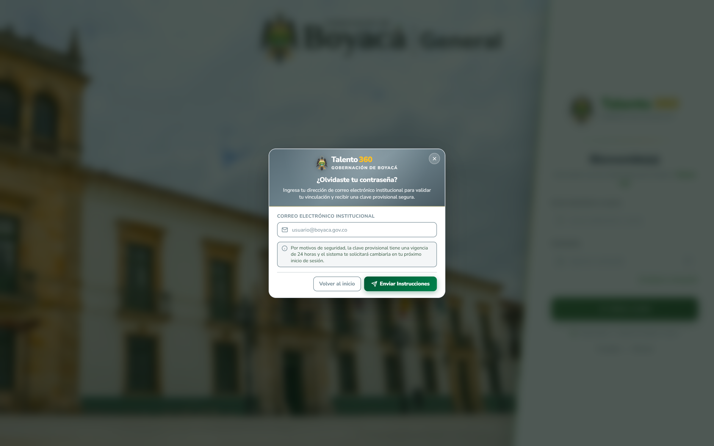 |
| *Acceso seguro con fondo oficial de la Gobernación de Boyacá y logotipo del Cóndor.* | *Envío de clave provisional con diseño compacto en gris institucional `#738993`.* |

#### Políticas de Seguridad y Elevación Administrativa
| Cambio Obligatorio de Clave Provisional | Confirmación y Elevación Admin (`#857352`) |
|:---:|:---:|
|  | 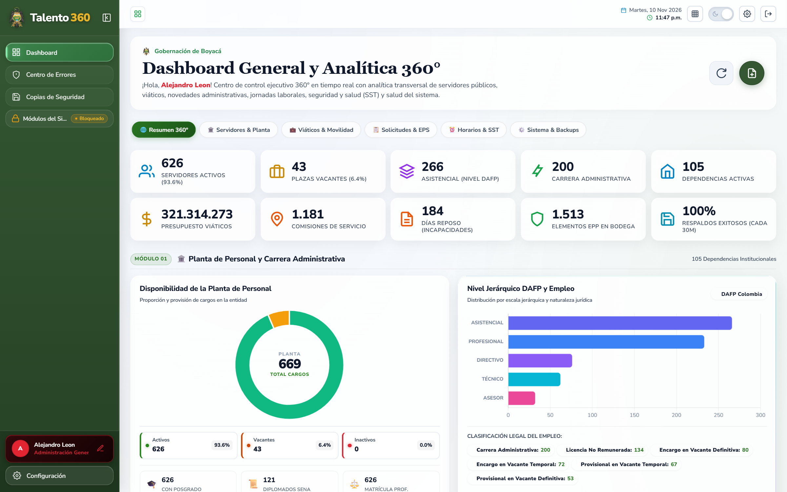 |
| *Validación dinámica de 4 criterios de robustez previo al primer acceso.* | *Diálogo de doble factor institucional con cabecera en ocre `#857352`.* |

#### Compromiso Normativo y Habeas Data
| Compromiso de Confidencialidad y Habeas Data |
|:---:|
| 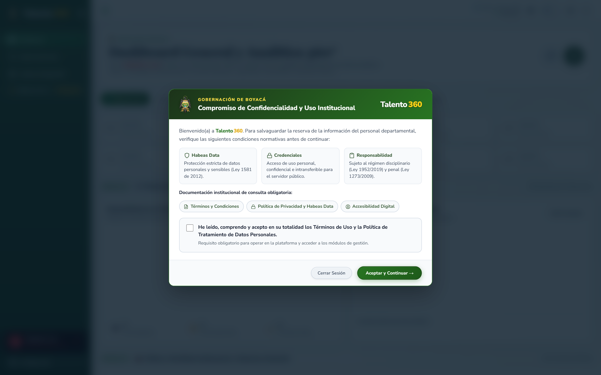 |
| *Consentimiento obligatorio en cumplimiento de la Ley 1581 de 2012, Ley 1952 de 2019 y Ley 1273 de 2009.* |

---

### 2. Dashboard General y Analítica 360°

Centro de control ejecutivo en tiempo real estructurado con **10 tarjetas KPI de liquid glass** dispuestas en una cuadrícula simétrica (2 filas de 5), gráficos de distribución de personal por sectoriales, estado de planta y exportación directa de informes oficiales en **PDF vectorial estandarizado** para firmas institucionales.


* **Fila 1 (Planta y Carrera):** Servidores Activos, Plazas Vacantes, Nivel Jerárquico DAFP Mayoritario, Carrera Administrativa y Dependencias Activas.
* **Fila 2 (Operaciones y Finanzas):** Presupuesto de Viáticos Comprometido, Total Comisiones de Servicio, Días de Incapacidad Médica, Elementos EPP en Bodega y Eficacia de Respaldos Automáticos.

---

### 3. Planta de Personal y Servidores Públicos

Administración exhaustiva de las hojas de vida digitales de servidores públicos activos, en encargo, provisionales o retirados.


- **Identificadores Atómicos `REL` (`REL00001`...):** Motor de concurrencia con bloqueos consultivos de base de datos que previene identificadores duplicados.
- **Importador Masivo Excel (`.xlsx`):** Sanitización contra inyección de fórmulas (**CWE-1236**), validación de 22 reglas departamentales y descarte automático de filas vacías.
- **Retiro y Revinculación:** Flujo formal de desvinculación por acto administrativo con congelamiento y preservación del histórico acumulado de antigüedad.

---

### 4. Estructura y Dependencias Departamentales

Directorio interactivo de las secretarías, direcciones, oficinas asesoras y dependencias de la Gobernación de Boyacá, homologadas con códigos internos y distribución por sedes físicas departamentales.


---

### 5. Gestión de Vacaciones y Días Hábiles

Módulo para radicación, cómputo y aprobación de períodos vacacionales ordinarios o compensados en dinero.

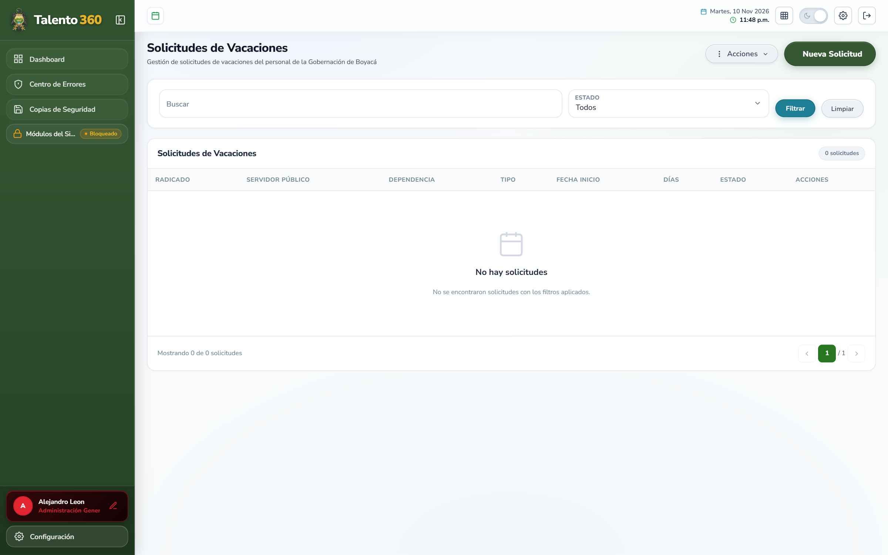

- **Cómputo Oficial de Días Hábiles:** Motor de calendario nacional que descuenta sábados, domingos y días festivos colombianos (**Ley Emiliani / Ley 51 de 1983**).
- **Interrupción y Reanudación Concertada:** Sincronización automática ante situaciones de incapacidad médica o activación de modalidades de trabajo en casa.

---

### 6. Permisos y Solicitudes Administrativas

Gestión integral de permisos laborales remunerados reglamentarios (hasta 3 días hábiles), comisiones y justificaciones administrativas con trazabilidad de aprobaciones jerárquicas.

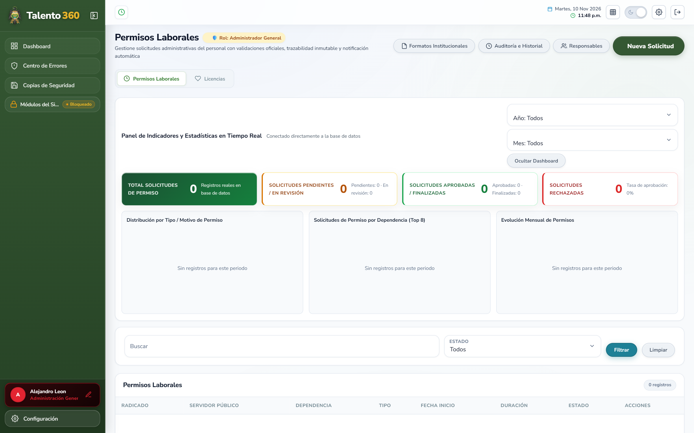

---

### 7. Licencias de Maternidad, Paternidad y Luto

Trámite estructurado de licencias de ley con radicación de soportes hospitalarios o notariales:


- **Maternidad:** 18 semanas de protección con validación de certificado médico de nacido vivo.
- **Paternidad (Ley María):** 2 semanas remuneradas con soporte de registro civil de nacimiento.
- **Luto (Ley 1280 de 2009):** 5 días hábiles remunerados ante parentesco de consanguinidad o afinidad.

---

### 8. Centro de Gestión de Incapacidades Médicas

Control epidemiológico y financiero de incapacidades laborales de origen común y profesional desglosadas por Entidad Promotora de Salud (**EPS**):


- **Desglose Analítico por EPS:** Seguimiento de días de reposo acumulados en Sanitas, Nueva EPS, Famisanar, Salud Total, ADRES, entre otras.
- **Clasificación CIE-10:** Registro de diagnósticos médicos con control de prórrogas que superen los 180 días continuos para trámite de concepto de rehabilitación.

---

### 9. Monitoreo de Horarios y Modalidades Especiales

Administración concertada de esquemas laborales modernos con control de presencia y cumplimiento normativo:

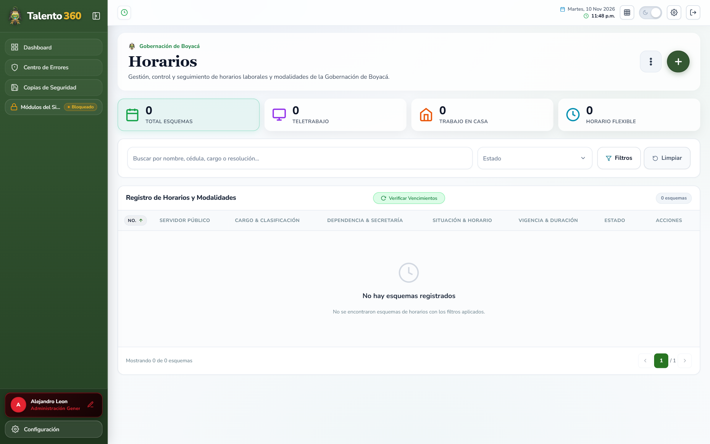

- **Teletrabajo (Ley 1221 de 2008 / Decreto 884 de 2012):** Modalidades autónoma, suplementaria y móvil.
- **Trabajo en Casa (Ley 2088 de 2021):** Habilitación excepcional por contingencias o necesidades de servicio.
- **Horario Flexible:** Ajuste de jornadas laborales para servidores con cargas familiares o estudio.
- **Desconvocatoria y Caducidad Automática:** El sistema transiciona a `Caducada` los acuerdos vencidos, reintegrando al servidor a presencialidad sin duplicar registros.

---

### 10. Comisiones y Viáticos Departamentales (DIVIPOLA)

Motor automatizado de liquidación de comisiones de servicio para el desplazamiento de servidores públicos en cumplimiento de funciones institucionales:

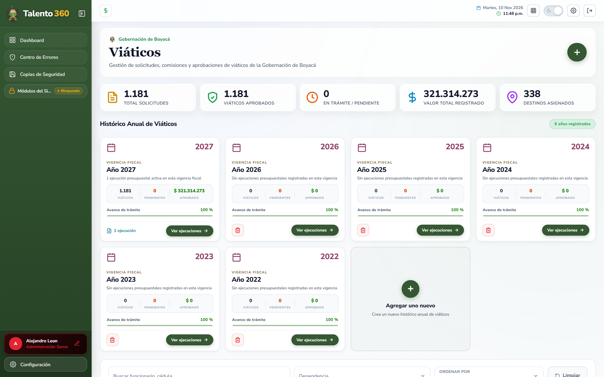

- **Catálogo Geográfico DIVIPOLA:** Cobertura oficial de los **123 municipios del departamento de Boyacá**, categorizados por provincia y distancia.
- **Escalas Tarifarias 2024–2026:** Cálculo automático según el nivel jerárquico (*Directivo, Asesor, Profesional, Técnico, Asistencial*), viático completo con pernoctada o medio viático.
- **Máquina de 4 Estados Canónicos:** `Radicado` $\rightarrow$ `Aprobado` $\rightarrow$ `En Ejecución` $\rightarrow$ `Legalizado`.
- **Blindaje Contable y Fiscal:** Bloqueo inmutable contra edición o borrado de comisiones legalizadas con soporte presupuestal cerrado.

---

### 11. Seguridad y Salud en el Trabajo (SST)

Módulo integral alineado con el Sistema de Gestión de la Seguridad y Salud en el Trabajo (**SG-SST**, Decreto 1072 de 2015 y Resolución 0312 de 2019):

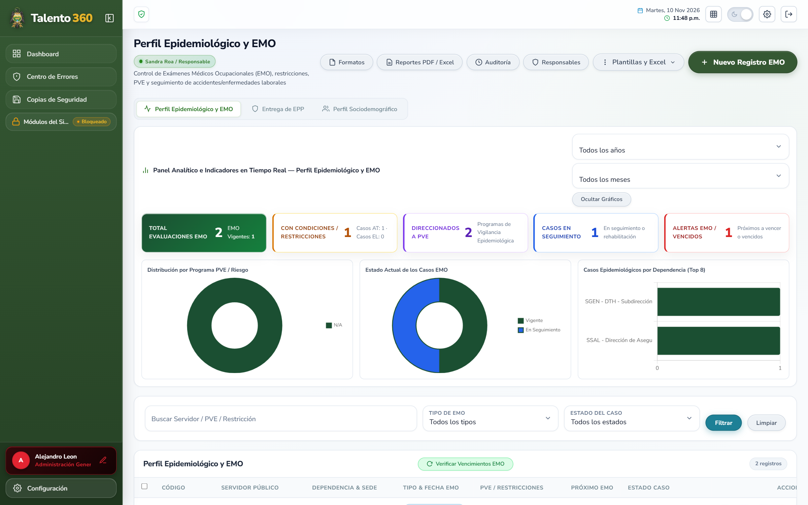

- **Perfil Epidemiológico y EMO:** Registro y seguimiento a Exámenes Médicos Ocupacionales (ingreso, periódicos, egreso, post-incapacidad) y restricciones médico-laborales.
- **Programas de Vigilancia Epidemiológica (PVE):** Gestión de casos direccionados a riesgo osteomuscular, psicosocial, cardiovascular, biológico y visual.
- **Accidentes e Incidentes (AT / EL):** Trazabilidad de eventos laborales reportados ante la Administradora de Riesgos Laborales (ARL Positiva).
- **Dotación y Stock de EPP:** Control de inventario físico, entregas con firma digital/constancia y alertas de reabastecimiento.
- **Caracterización Sociodemográfica:** Batería analítica de variables de salud, vivienda, educación y entorno familiar de los servidores.

---

### 12. Copias de Seguridad y Respaldo (Backups)

Centro de contingencia y resiliencia de datos para garantizar la continuidad operativa de la entidad:

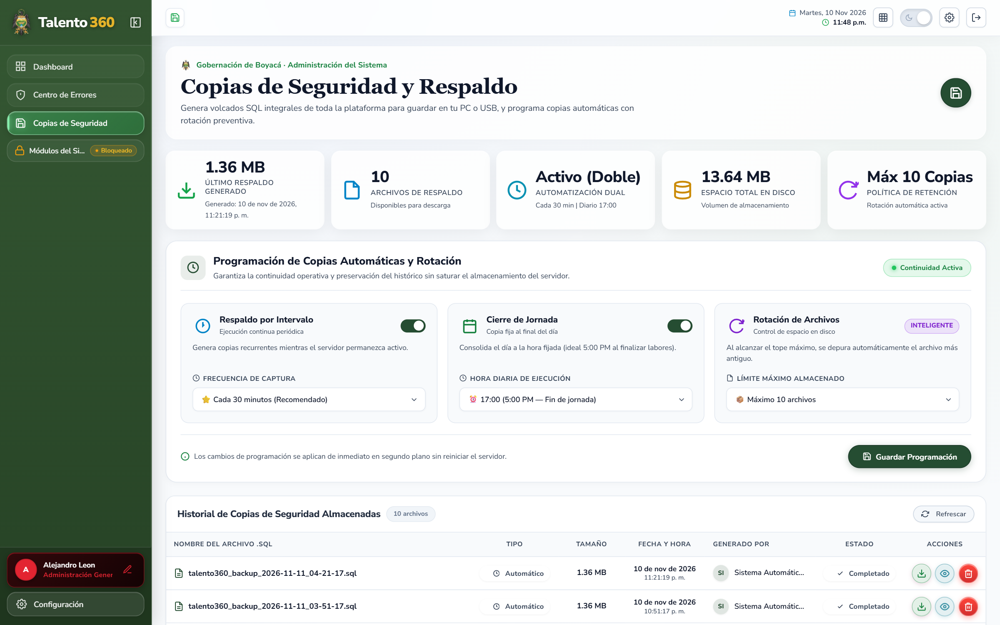

- **Automatización Dual:** Generación periódica programable (cada 30 minutos) y respaldo de consolidación diario al cierre de jornada (17:00).
- **Descargas Protegidas:** Acceso autenticado mediante token administrativo `Bearer` y políticas de rotación preventiva que mantienen un límite configurable de archivos en disco.
- **Verificación en Sandbox:** Algoritmo que comprueba la consistencia de los volcados SQL en un esquema transaccional aislado con *rollback* preventivo.

---

### 13. Consola de Monitoreo Técnico de Incidentes

Supervisión continua en tiempo real de la estabilidad operativa del frontend y del clúster de microservicios:

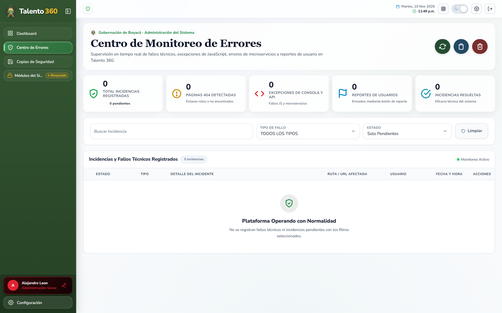

- **Captura Global de Excepciones:** Registro de errores no controlados de JavaScript, fallos de red en llamadas API y páginas 404 detectadas.
- **Inspección de Pila (Stack Trace):** Detalle técnico de la traza de ejecución, función afectada, módulo y usuario implicado.
- **Gestión de Estados:** Clasificación de severidad y ciclo de vida de incidentes (`Pendiente` $\rightarrow$ `Resuelto`).
- **Resolución de IP Real:** Sanitización estricta de encabezados de proxy para auditoría forense.

---

## 🏗️ Arquitectura Tecnológica y Microservicios

La plataforma implementa un modelo de **arquitectura desacoplada de microservicios** orientada al rendimiento, modularidad y fácil escalabilidad:

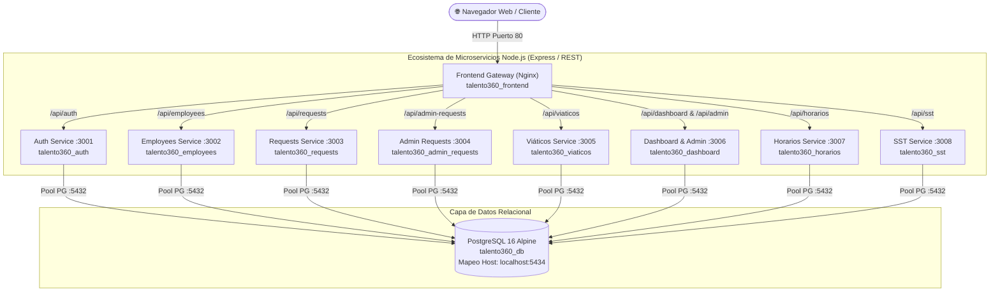

### Inventario de Contenedores Docker

| Servicio | Contenedor | Puerto Interno | Puerto Host | Responsabilidad Operativa |
|---|---|---|---|---|
| **Frontend Gateway** | `talento360_frontend` | `80` | `80` | Servidor Nginx SPA, reverse proxy HTTP/1.1 y distribución de estáticos |
| **Auth Service** | `talento360_auth` | `3001` | Interno | Autenticación JWT, verificación de credenciales, roles y recuperación de claves |
| **Employees Service** | `talento360_employees` | `3002` | Interno | Planta de personal, secuencia `REL`, retiros, revinculaciones e importación Excel |
| **Requests Service** | `talento360_requests` | `3003` | Interno | Solicitudes y cómputo de días hábiles de vacaciones de ley |
| **Admin Requests** | `talento360_admin_requests` | `3004` | Interno | Permisos remunerados, justificaciones administrativas y licencias |
| **Viáticos Service** | `talento360_viaticos` | `3005` | Interno | Comisiones de servicio, motor tarifario 2024–2026, DIVIPOLA y estados canónicos |
| **Dashboard Service** | `talento360_dashboard` | `3006` | Interno | Agregación de 10 KPIs ejecutivos, consola de errores, backups y exportador PDF |
| **Horarios Service** | `talento360_horarios` | `3007` | Interno | Teletrabajo, trabajo en casa, horarios flexibles, desconvocatorias y asistencia |
| **SST Service** | `talento360_sst` | `3008` | Interno | SG-SST: perfil epidemiológico, EMO, inventario EPP, AT/EL y sociodemográfico |
| **PostgreSQL Database** | `talento360_db` | `5432` | `5434` | Base de datos relacional (29 tablas normalizadas, esquemas `01_` a `10_`) |

---

## 🔒 Ciberseguridad y Blindaje Normativo

La plataforma ha sido rigurosamente auditada (**AUD-001** a **AUD-014**) para garantizar estándares de ciberseguridad gubernamental:

| Vector / Hallazgo | Mitigación Técnica Implementada |
|---|---|
| **Formula Injection (CWE-1236)** | Sanitización exhaustiva en importación/exportación Excel y CSV. Neutralización de disparadores (`=`, `+`, `-`, `@`, `\|`, `%`) anteponiendo comilla simple `'` mientras se preservan valores numéricos negativos legítimos. Exportación con Byte Order Mark UTF-8 (`\uFEFF`). |
| **Timing Attacks en Login** | Comparación con hash precomputado (`DUMMY_HASH`) cuando el usuario no existe en la base de datos, impidiendo la enumeración de cuentas por discrepancias en tiempos de respuesta. |
| **Control de Sesión 401** | Interceptor centralizado que despliega un modal in-situ de autenticación (`z-index: 100000`) preservando el estado del usuario y respaldando automáticamente borradores de formularios activos (`saveCurrentFormDraft`). |
| **Falsificación de IP (Spoofing)** | Configuración de `trust proxy` en Express que valida direcciones IP reales en arquitecturas de balanceo reverso de Nginx. |
| **Control de Acceso Granular (RBAC)** | Desacople de autorizaciones por permisos explícitos (`employees:write`, `horarios:read`, `admin-backups:download`, `sst:*`). |
| **Integridad de Base de Datos** | Claves foráneas estrictas, índices B-Tree de alto rendimiento y cláusulas `ON DELETE RESTRICT` para blindar expedientes históricos. |

---

## 🔑 Credenciales, Roles y Perfiles del Sistema

Para pruebas y despliegue inicial, la plataforma cuenta con las siguientes cuentas institucionales configuradas:

| Correo / Usuario | Contraseña | Perfil Institucional | Módulos y Alcance de Gestión |
|---|---|---|---|
| `alejoleo2022@gmail.com` | `@Alejo123` | **Administrador General** | Acceso irrestricto a todos los módulos (`*`), consola de errores y copias de seguridad. |
| `silvaespejojuanesteban@gmail.com` | `admin123` | **Gestor de Respaldo y Horarios** | Acceso exclusivo asignado al **Centro de Monitoreo de Horarios** y **Copias de Seguridad (Backups)**. |
| `admin` | `admin123` | **Administrador Local Base** | Gestión técnica del sistema e infraestructura local. |
| `angela.ussa@boyaca.gov.co` | `@Angela123` | **Dirección de Talento Humano** | Gestión de planta de personal, creación de cargos, retiros y reportes ejecutivos. |
| `blanca.soler@boyaca.gov.co` | `@Blanca123` | **Gestión de Personal** | Servidores públicos, novedades y actualización de expedientes. |
| `doris.canon@boyaca.gov.co` | `@Doris123` | **Control de Jornadas y Horarios** | Modalidades laborales concertadas (teletrabajo, trabajo en casa, flexible). |
| `bergenet.gutierrez@boyaca.gov.co` | `@Bergenet123` | **Viáticos y Comisiones** | Radicación y liquidación de comisiones en los 123 municipios boyacenses. |
| `sandra.roa@boyaca.gov.co` | `Sandra@123` | **Especialista SG-SST** | Evaluaciones médicas (EMO), vigilancia epidemiológica, EPP y sociodemográfico. |
| `luis.sanchez@boyaca.gov.co` | `Luis@456` | **Gestor de Incapacidades** | Radicación, prórrogas y seguimiento de incapacidades por EPS. |

---

## 🚀 Instalación y Despliegue Rápido

### Prerrequisitos
* **[Docker Desktop](https://www.docker.com/products/docker-desktop/)** (con Docker Compose v2+)
* **[Node.js](https://nodejs.org/)** versión 20 LTS o superior
* **[Git](https://git-scm.com/)**

### 1. Clonar el repositorio
```bash
git clone https://github.com/JuanEstebanSilva/talento360.git
cd talento360/web
```

### 2. Configurar variables de entorno
```powershell
# En Windows (PowerShell):
Copy-Item .env.example .env

# En Linux / macOS / Bash:
cp .env.example .env
```

> [!NOTE]
> Para evitar conflictos con instancias existentes de PostgreSQL en el puerto por defecto 5432, el archivo `.env` expone la base de datos contenerizada en el puerto host **`5434`** (`localhost:5434`).

### 3. Construir e iniciar los microservicios
```bash
docker compose up --build -d
```
Este comando:
1. Crea la red interna privada `talento360_net`.
2. Inicia el motor PostgreSQL 16 ejecutando automáticamente los esquemas SQL (`01_schema.sql` a `10_sst_module.sql`).
3. Compila los 8 microservicios Node.js en contenedores independientes.
4. Levanta el servidor web Nginx como proxy reverso de alto rendimiento.

### 4. Abrir en el navegador
Ingresa a: **[http://localhost](http://localhost)**

---

## 🎨 Paleta Gráfica y Colorimetría Oficial

La plataforma refleja la identidad visual y el patrimonio de Boyacá mediante tokens de diseño estandarizados:

| Color | Código Hex | Uso Principal en la Plataforma |
|---|---|---|
| **Verde Boyacá Principal** | `#005A36` | Botones de acción principal, acentos institucionales y llamadas a la acción. |
| **Verde Bosque Oscuro** | `#092C1E` | Fondos de sidebar institucional y contrastes de cabecera. |
| **Gris Institucional Boyacá** | `#738993` | Cabeceras de modales de autenticación, bordes finos, etiquetas y cajas de asesoría. |
| **Ocre Departamental** | `#857352` | Cabecera y distintivos del diálogo de confirmación/desbloqueo administrativo. |
| **Oro Boyacá / Amarillo** | `#D1AD2A` / `#FBBF24` | Insignia numérica `360`, iconos de advertencia y destacados dorados. |
| **Naranja Institucional** | `#D14600` | Botones de guardado de cambios en formularios y asistentes modales. |
| **Rojo Bandera Boyacá** | `#C42B1C` | Indicadores de alerta, retiro de servidores y acciones destructivas. |

---

## 🛠️ Comandos de Mantenimiento Frecuente

Ejecutar siempre desde la carpeta `web/`:

```powershell
# Ver estado de los 10 contenedores
docker compose ps

# Ver registros en tiempo real (logs globales)
docker compose logs -f

# Reiniciar un microservicio específico
docker compose restart <servicio>

# Recargar el frontend en Nginx sin reiniciar contenedores
docker exec talento360_frontend nginx -s reload

# Detener los contenedores preservando datos
docker compose stop

# Apagar y desmontar el clúster
docker compose down
```

---

## 📄 Licencia y Uso Institucional

Desarrollado para la **Gobernación de Boyacá** — Subdirección de Talento Humano.  
Todos los derechos reservados © 2026. Prohibida su reproducción o distribución sin autorización expresa de la entidad.
