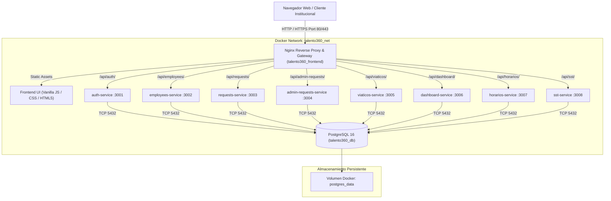

# Arquitectura Técnica de Talento 360
## Gobernación de Boyacá — Dirección de Talento Humano

---

## 1. Visión General de la Arquitectura

**Talento 360** es un sistema modular distribuido implementado bajo una arquitectura orientada a microservicios desacoplados y contenerizados con Docker, diseñado para ofrecer alta disponibilidad, aislamiento de fallos, escalabilidad horizontal y cumplimiento riguroso de integridad institucional en la gestión del talento humano de la Gobernación de Boyacá.



---

## 2. Capas del Sistema

### 2.1. Capa de Presentación (Frontend)
- **Tecnología:** HTML5, CSS3 institucional unificado (Colorimetría oficial: Verde Gobernación `#355833`, Dorado institucional `#eab308` / `#ca8a04`), y JavaScript nativo moderno (ES6+ modular).
- **Enfoque Cero Dependencias Pesadas:** No requiere librerías pesadas en tiempo de cliente (React, Angular o Vue), garantizando carga instantánea (<300ms) en redes internas de baja velocidad y equipos de oficina con recursos moderados.
- **Servidor Web y Proxy:** Servido a través de **Nginx 1.25 Alpine**, el cual además actúa como API Gateway enrutando las peticiones con prefijo `/api/*` hacia sus respectivos microservicios backend.

### 2.2. Capa de Servicios de Negocio (Backend Microservicios)
Cada microservicio corre de forma autónoma en un contenedor Node.js 20 Alpine, tiene su propio archivo `package.json`, maneja su propio pool de conexiones a la base de datos y expone endpoints REST documentados:

1. **`auth-service` (Puerto 3001):**
   - Autenticación mediante credenciales institucionales.
   - Hashing con `bcrypt` (cost factor 12) y mitigación de ataques de temporización (*dummy hash*).
   - Generación y verificación de tokens JWT criptográficos.
   - Flujo de restablecimiento seguro de contraseñas con tokens de un solo uso y vigencia de 24 horas.
2. **`employees-service` (Puerto 3002):**
   - Directorio de servidores públicos, hoja de vida, planta de personal y clasificación censal.
   - Gestión de estado del funcionario (Activo, Retirado, Vacante).
   - Importación masiva con validación estricta de documentos y DTO transaccional.
3. **`requests-service` (Puerto 3003):**
   - Radicación y seguimiento de solicitudes individuales de funcionarios (vacaciones, permisos remunerados, licencias).
4. **`admin-requests-service` (Puerto 3004):**
   - Bandeja de gestión y aprobación de solicitudes para coordinadores y dirección de talento humano.
5. **`viaticos-service` (Puerto 3005):**
   - Registro y procesamiento de comisiones de servicios y viáticos.
   - Detección inteligente de duraciones con 12 reglas de normalización.
   - Parsing robusto de fechas de resolución y protección de integridad referencial contra eliminaciones en cascada.
6. **`dashboard-service` (Puerto 3006):**
   - Consolidación de KPIs ejecutivos en tiempo real.
   - Generación de reportes PDF vectoriales con diseño institucional oficial.
   - Consola de errores del sistema y registro de actividad de respaldos.
7. **`horarios-service` (Puerto 3007):**
   - Gestión de acuerdos laborales especiales: Teletrabajo, Trabajo en Casa y Horario Flexible.
   - Validación de solapamientos temporales y control de vigencias.
   - Aislamiento transaccional estricto (no crea personas stub ni altera el censo de funcionarios).
8. **`sst-service` (Puerto 3008):**
   - Módulo de Seguridad y Salud en el Trabajo.
   - Evaluaciones Médicas Ocupacionales (EMO), entrega de Elementos de Protección Personal (EPP) y caracterización sociodemográfica.

### 2.3. Capa de Datos (PostgreSQL 16)
- **Persistencia:** Volumen Docker gestionado `postgres_data`.
- **Integridad Referencial:** Claves foráneas con restricción estricta (`ON DELETE RESTRICT`) entre tablas padre (como `paquetes_viaticos`, `personas`) y tablas de transacciones (`viaticos`, `horarios`, etc.).
- **Inicialización Idempotente:** Carpeta `database/` montada en `/docker-entrypoint-initdb.d:ro`, ejecutando scripts ordenados `01_` a `29_` sin colisiones.

---

## 3. Modelo de Seguridad y Control de Acceso (RBAC)

El sistema cuenta con una arquitectura de seguridad transversal basada en permisos granulares desacoplados:

```text
Usuario ──(autenticación)──> Rol Institucional ──(asignación)──> Conjunto de Permisos
```

### Roles Institucionales y Perfiles:
- **`administrador`:** Acceso total de gestión y configuración de la plataforma.
- **`coordinador_talento`:** Aprobación de trámites, gestión de planta y visualización ejecutiva.
- **`analista_servidores`:** Gestión operativa exclusiva de Servidores Públicos (`employees:write`, lectura transversal).
- **`analista_horarios`:** Gestión operativa de acuerdos de jornada laboral (`horarios:write`, lectura transversal).
- **`analista_viaticos`:** Registro, importación y procesamiento de viáticos (`viaticos:write`, lectura transversal).
- **`analista_sst`:** Gestión de expedientes de seguridad y salud en el trabajo (`sst:write`, lectura transversal).
- **`funcionario`:** Portal de autoservicio para consulta de expediente personal y radicación de solicitudes.

---

## 4. Redes y Comunicaciones

- **Red Privada Docker (`talento360_net`):**
  - Los 8 microservicios y la base de datos se comunican internamente por nombres de host DNS de Docker (`postgres`, `auth-service`, `employees-service`, etc.).
  - Ningún microservicio expone puertos directamente al host en producción, únicamente el contenedor `talento360_frontend` expone el puerto `80` (HTTP) y opcionalmente `443` (HTTPS).
  - En entorno de desarrollo, el puerto de PostgreSQL se enlaza a `localhost:5434` para permitir herramientas de diagnóstico administrativo sin entrar al contenedor.
